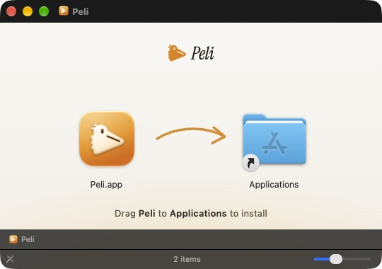

# macOS packaging: a drag-to-Applications DMG per architecture, signed with the hardened runtime and notarized

#78 packages Peli for macOS. Installing should be what Mac users expect from a small app: open the DMG, drag Peli onto Applications, done. There's no installer to click through and nothing to approve in System Settings. `build/darwin/dist.sh` does the work, and `wails3 task darwin:release ARCH=arm64|amd64` runs it end to end.

## One DMG per architecture, not universal

`Peli-<version>-arm64.dmg` and `Peli-<version>-x86_64.dmg`, each with a one-architecture binary and the matching build of our libmpv (ADR-0041). ADR-0005's 60 MB limit is per architecture, and #80's release and #88's size check are planned around per-arch DMGs. A universal app would also need a universal libmpv (`lipo` of both builds), which nearly doubles the largest file in the bundle for every user. So `build:universal` and `package:universal` are gone from the Taskfile: they bundled one architecture's libmpv next to a two-architecture binary.

Sizes at 0.1.0 (2026-11-12, ad hoc, on an M1 Pro):

| | App unpacked | DMG (ULMO) | Same DMG as UDZO |
|---|---|---|---|
| arm64 | 61 MB | 19.3 MB | 27.2 MB |
| x86_64 | | 22.3 MB | |

## The DMG

Wails' `tool package --format dmg` builds the Finder window: Peli on the left, an `Applications` link on the right, a 540 × 380 background with an arrow between them and "Drag Peli to Applications to install" below. The background is `dmg-background.tiff`, 1× and 2× in one file so it stays sharp on Retina screens. Its source is `dmg-background.html`, which has the render command. The wordmark sits at the top, because Finder's path and status bars, when the user has them on, cover the bottom of the window.

Wails writes UDZO (zlib). `dist.sh` converts the image to **ULMO** (LZMA, macOS 10.15 or later, below our minimum of 12), which is about 30 % smaller. Then it signs the DMG and fails if it is over 60,000,000 bytes.

The bundle is now `Peli.app` (Finder shows "Peli" in Applications). The executable inside it is still `peli`.

## Signing: hardened runtime, no exceptions

`dist.sh sign` signs inside out: `Contents/Frameworks/libmpv.2.dylib` first, then the app. Both get `--options runtime`, and both get `--timestamp` when signing with a certificate. It doesn't use `--deep`, which would sign nested code without those flags, and notarization rejects that. `entitlements.plist` is empty:

- Go, cgo and libmpv don't JIT. WebKit's JIT runs in WebKit's own XPC processes, which are signed by Apple.
- libmpv is in the bundle and signed with the same Team ID, so library validation passes.
- Playback only outputs audio. CoreAudio output, VideoToolbox and OpenGL need no entitlement. libmpv's smoke test gave the same result signed with and without the hardened runtime.

The identity is `PELI_SIGN_IDENTITY`. Without it, every local `wails3 package` signs **ad hoc but still with the hardened runtime**, so local builds run under the same rules as releases. The one difference: an ad-hoc signature has no Team ID, and dyld then refuses to load libmpv ("mapping process and mapped file have different Team IDs"). Ad-hoc builds therefore use `entitlements.adhoc.plist`, which only adds `disable-library-validation`. `dist.sh check` fails a Developer ID build that still carries it.

`dist.sh check` is what a shipped bundle must be: the binary and libmpv in the stated architecture, linked to `@rpath/libmpv.2.dylib` with `@executable_path/../Frameworks` as the only rpath, nothing outside `/usr/lib` and `/System`, a valid signature, and the hardened runtime. CI runs it on both Mac builds.

The darwin build puts `pkg-config --cflags mpv` into `CGO_CFLAGS`. Go's cache key includes `CGO_CFLAGS` but not `PKG_CONFIG_PATH`. Without the flags in it, a build after switching between Homebrew's libmpv and ours kept linking the old one.

## Notarization

`dist.sh notarize` submits with `xcrun notarytool --wait`, prints Apple's log if the submission isn't accepted, staples the ticket and checks the result with `spctl`. A release notarizes twice: first the app (as a zip), and its ticket is stapled to the app itself, so Peli opens offline once it is copied out of the DMG. Then it notarizes the DMG, so Gatekeeper's first look, when the user opens the download, passes too. The credentials are `PELI_NOTARY_PROFILE` (a profile saved with `notarytool store-credentials`) for a Mac, or an App Store Connect API key (`PELI_NOTARY_KEY`, `_KEY_ID`, `_ISSUER`) for CI (#80).

## The keychain trusts Peli's signature (ADR-0007's revisit)

A Developer ID build now calls Security.framework directly (`internal/secrets/native_darwin.go`), so new items trust Peli's designated requirement (bundle ID and Team ID, the same for every update) instead of `/usr/bin/security`. Any other build, meaning `go run`, tests and ad-hoc packages, still uses go-keyring: its signature changes with every build, and items that trusted it would prompt after each one. Which backend to use is decided at launch by whether the running code's signature has a Team ID.

**Migration.** The first time a Developer ID build uses the keychain, it lists the `Peli` service's accounts (attributes only, no secrets) and rewrites each item as its own. Then it saves a `_native` marker item, which no key can collide with, because keys have no underscores. A probe on macOS 27 settled the details. Security.framework can read and update an item the security tool made, without a prompt, but it can't delete it ("Invalid attempt to change the owner of this item", -25244). So native `set` always deletes and adds, never updates (an update would keep the tool's access list), and when Peli isn't allowed to delete an item, it deletes it through the tool. Every call passes `kSecUseAuthenticationUIFail`, so an item Peli may not read fails instead of showing a dialog. Values keep go-keyring's `go-keyring-base64:` encoding.

## What we give up

- **Two downloads.** The website or release page has to offer the right one (Apple silicon or Intel). Universal would have been one file at about 1.7× the size.
- **Development builds prompt once on a Mac that has run a release.** After the migration, the items no longer trust the security tool, so a go-keyring build asks to use them. "Always Allow" puts the tool back on the item's access list.
- **Going back to a pre-#78 build prompts too**, for the same reason.
- **Nothing is notarized yet.** This Mac has no Developer ID certificate. Until one is set up (Apple Developer Program, a "Developer ID Application" certificate, `notarytool store-credentials`), the DMGs are ad-hoc signed, and macOS 15+ blocks them unless the user allows them in System Settings › Privacy & Security.
- `hdiutil` prints a deprecation warning for `attach`, `convert` and `imageinfo` on macOS 27 (pointing at `diskutil image`). It still works. Wails' DMG builder uses it too.

## Revisit when

- The DMG goes over 40 MB on either architecture (two-thirds of the limit): look at what grew before it fails the release.
- Apple removes `kSecUseAuthenticationUIFail`: switch to an `LAContext` with `interactionNotAllowed`, which needs a little Objective-C.
- Auto-update (#83) lands. It replaces the app in place, so it has to keep the signature (same Team ID) for the keychain items to stay readable without a prompt.
