# Design system

Sinag has one theme, in light and dark (#13; theme studio is cut). The direction: **Apple's** glass and spring motion, **Vercel's** monochrome precision, **Nuvio's** poster-first, near-black cinema.

The living reference is the in-app gallery: **Settings › Design system** (`/gallery`). It shows every token and component in its states and measures contrast live.

## Where things live

| What | Where |
|---|---|
| Tokens: colour, type, spacing, radius, elevation, motion | `frontend/src/index.css` (`:root` light, `.dark` dark, the `@theme` blocks) |
| Light/dark: OS by default, System/Light/Dark override | `frontend/src/lib/theme.ts`, the inline script in `frontend/index.html`, the window colour in `main.go` |
| WCAG AA checks for every colour pairing | `frontend/src/lib/contrast.ts` (`contrastPairs`), `contrast.test.ts` |
| Base components (button, dialog, sheet, toast, skeleton, toggle, badge, menu, tooltip…) | coss ui, `frontend/src/components/ui` (add more with `pnpm dlx shadcn@4.21.4 add @coss/<name>`) |
| Sinag's own: poster and landscape cards, row, hero, chip, skeletons | `frontend/src/components/media` |

## Rules of thumb

- **Colour:** surfaces are greys; the one accent is `--brand`, the "lagoon" (`#33b5e0` dark, `#0b6e94` light). Use it for focus, progress, selection and small highlights, never for large fills. coss's `--accent` is its hover tint, not the brand.
- **Contrast:** a new foreground/background pairing goes into `contrastPairs`, so the test holds it to AA (4.5:1 text, 3:1 UI) in both modes. Keep colour tokens as hex so the test can read them.
- **Over artwork, stay dark:** the hero and the progress bar scope themselves with `.dark`, since artwork is dark in either theme.
- **Type:** Mona Sans. Use `font-heading` plus `font-stretch-expanded` (display) or `font-stretch-semi-expanded` (titles, row headings) for headings, normal width for UI. Geist Mono `text-meta` for metadata (`2025 · 1h 52m`).
- **Motion:** `ease-spring` for lifts and presses, `ease-smooth` for fades and travel, durations from `--duration-fast|base|slow`. Put movement behind `motion-safe:`; reduced motion zeroes the durations.
- **Focus:** every interactive element shows a ring in `--ring` (the brand), either its own `focus-visible:ring-*` or the global `:focus-visible` outline. Cards ring their artwork. The gallery test audits this.
- **Window colour:** if `--sidebar` changes, update `windowColours` in `theme.ts` (a test checks it) and the colours in `main.go`.

## Screenshots

| | Dark | Light |
|---|---|---|
| Overview |  |  |
| Hero |  |  |
| Rows / components |  |  |
| Contrast |  | |

The macOS app at launch in dark mode: 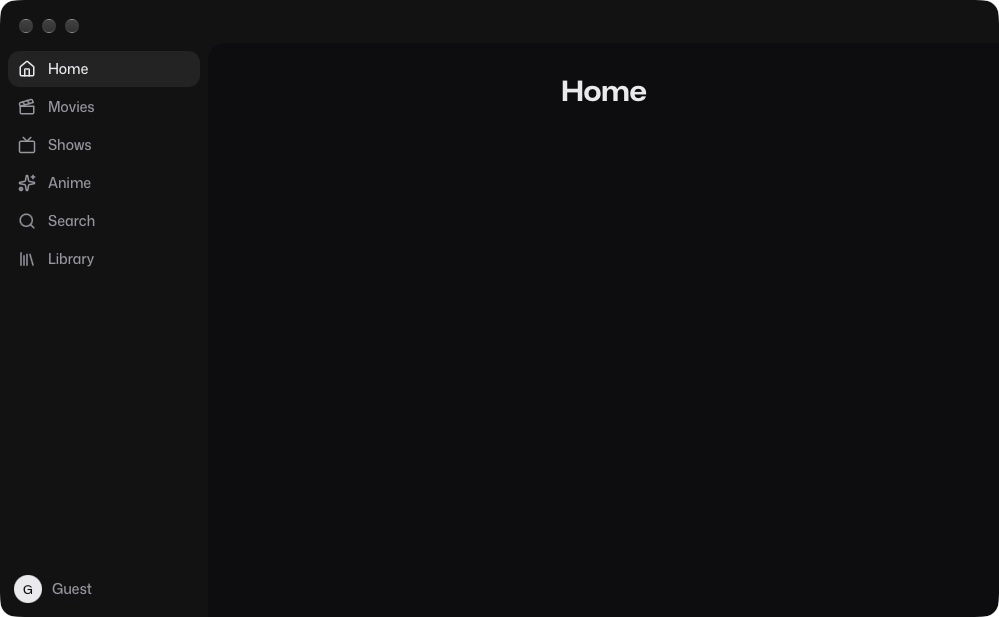

The gallery shots are from Chrome at 1280×800 (2×); the macOS one is the app window.

### Welcome and sign-in (#20)

First run, in the macOS app: 

| | |
|---|---|
| No keychain (Linux without a Secret Service) |  |
| Wrong password |  |
| Network down | 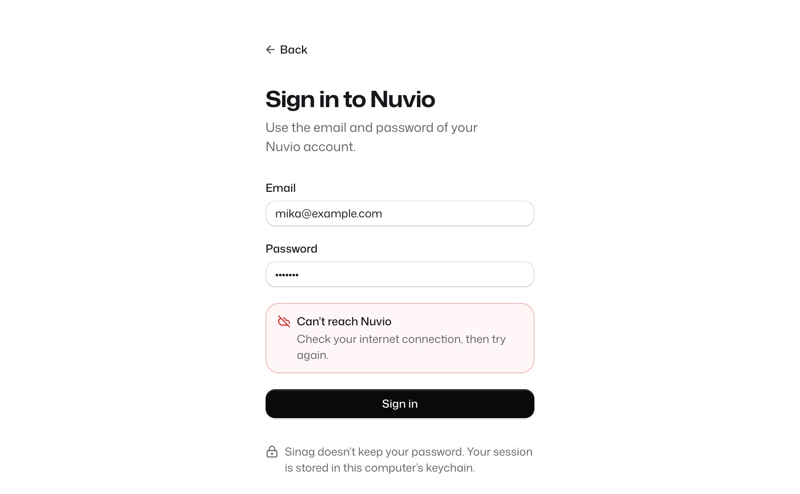 |
| Rate limited | 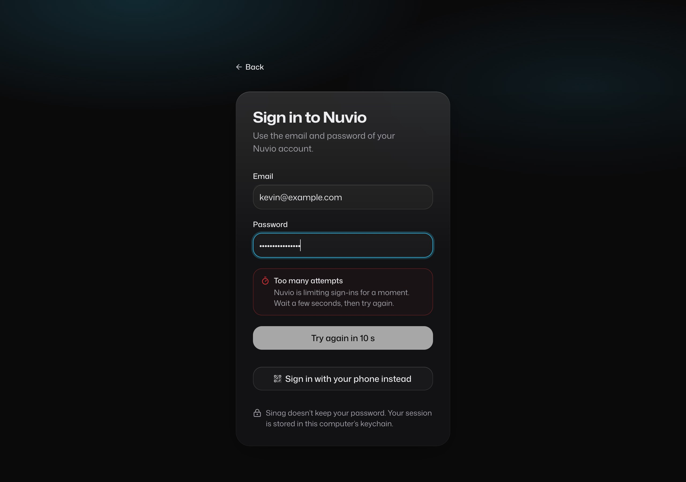 |
| Nuvio returns a server error |  |

These are from Chrome at 1000×618 (2×), with the Go services stubbed. Before there's a profile, the screens use the `focus` chrome: the title bar only, no sidebar.

### QR sign-in (#21)

| | |
|---|---|
| Waiting: the QR code opens nuvio.tv/link with the code filled in; the short code is for typing there on any device, and the countdown runs to the 5-minute expiry ([ADR-0013](../adr/0013-qr-sign-in-via-nuvio-link.md)) |  |
| Expired: one click for a new code | 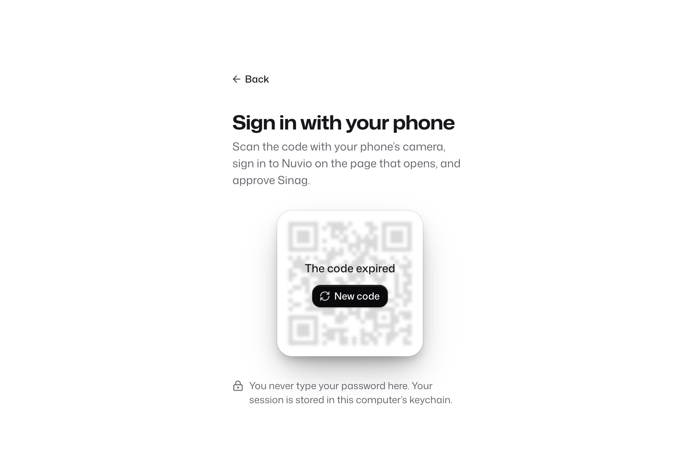 |
| Couldn't start (offline): the sign-in errors, with Try again | 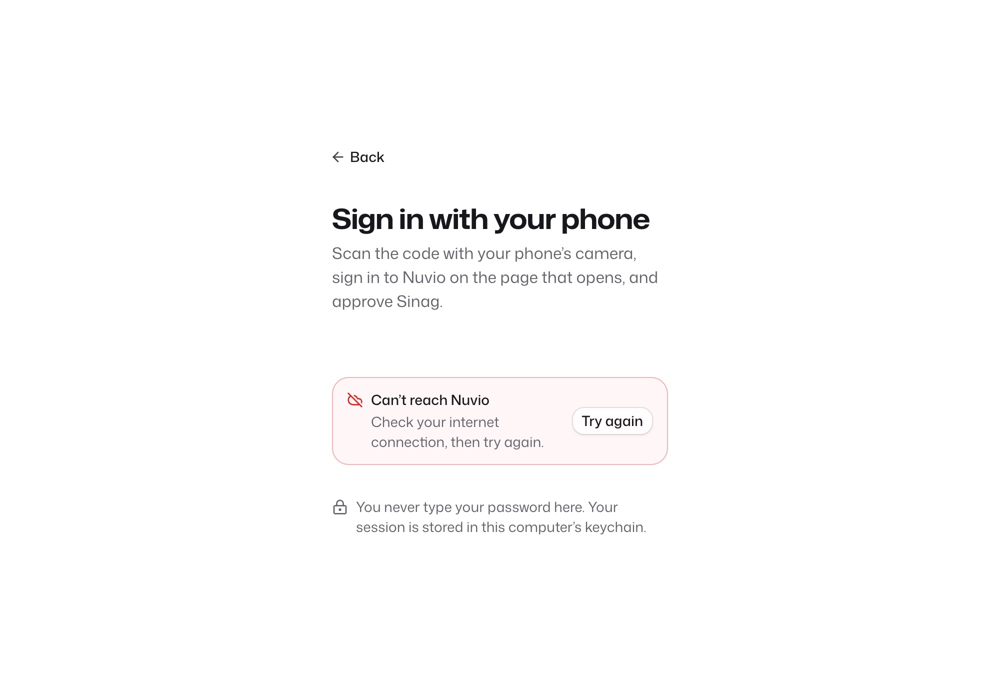 |

The QR is black modules on a white tile in both themes (21:1), because phone cameras read dark on light best. Chrome at 1000×680 (2×), with the Go services stubbed.

### Signing out and ended sessions (#22)

| | |
|---|---|
| Signed in: Settings offers Sign out | 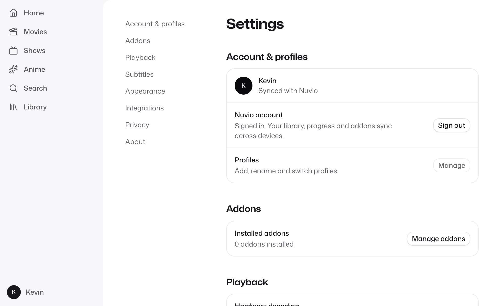 |
| Sign out asks first | 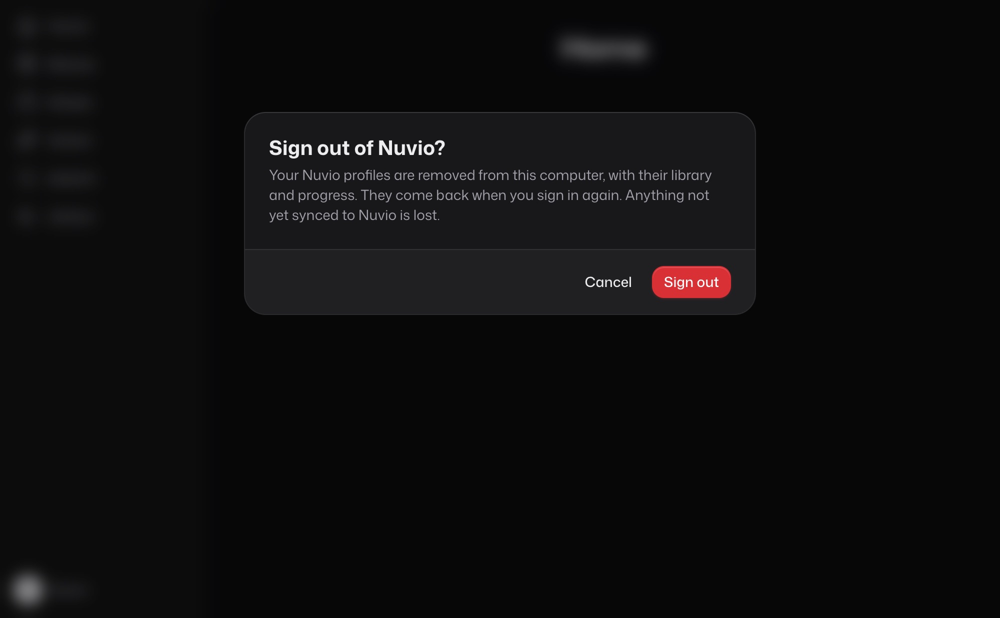 |
| The session ended (revoked or expired): at launch, or as soon as Go notices |  |
| After "Not now": the profile menu offers Sign in again |  |
| …and so does Settings, which still offers Sign out to remove the account's data |  |

Chrome at 1000×618 (2×), with the Go services stubbed.

### Guest mode (#23)

| | |
|---|---|
| First run: the welcome screen says what a guest keeps and that the Guest stays as it is |  |
| A guest's profile menu offers Sign in to Nuvio instead of Sign out |  |
| Signing in from the Guest: its profile stays apart from the account's ([ADR-0010](../adr/0010-guest-data-stays-apart.md)) |  |

Chrome at 1000×618 (2×), with the Go services stubbed.

### Profile picker (#24)

| | |
|---|---|
| At launch with more than one profile: the last one used is focused, and Nuvio's avatars show on their colours |  |
| Offline, or before an image loads: initials on the profile's colour, the Guest on the lagoon brand ([ADR-0011](../adr/0011-profile-avatars-and-picker.md)) |  |
| The profile menu switches in place |  |
| Settings › Profiles opens the picker | 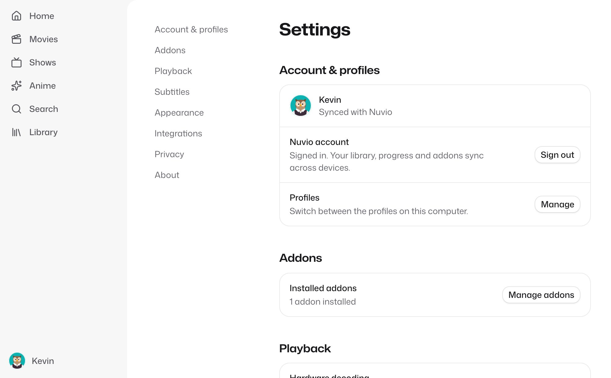 |
| The picker removes the Guest after asking |  |
| A guest on their own: the picker offers to sign in |  |

Chrome at 1000×618 (2×), with the Go services stubbed. Avatar images are Nuvio's, from its public catalog.

### Managing profiles (#95)

| | |
|---|---|
| **Manage profiles** in the picker, the profile menu or Settings › Profiles: a pencil badge on each tile, and **Add profile** while the account has a free slot | 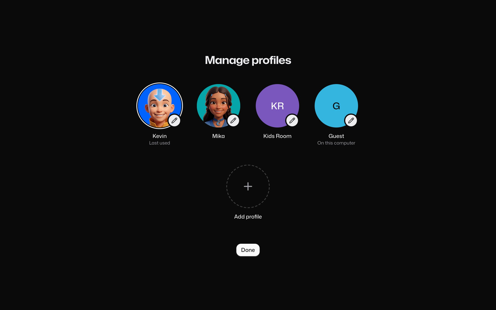 |
| Editing a Nuvio profile: name, one of Nuvio's stock avatars (picking one takes the colour it was drawn for) and a colour. **Delete** isn't offered for the primary or the last profile ([ADR-0012](../adr/0012-profile-changes-go-to-nuvio-first.md)) | 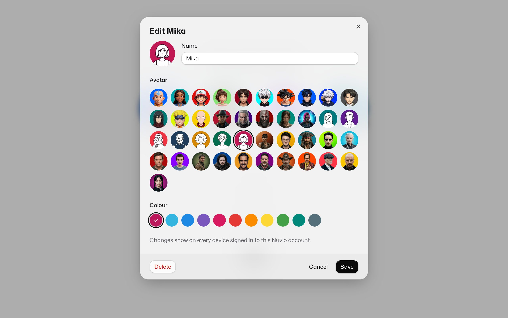 |
| Adding a profile | 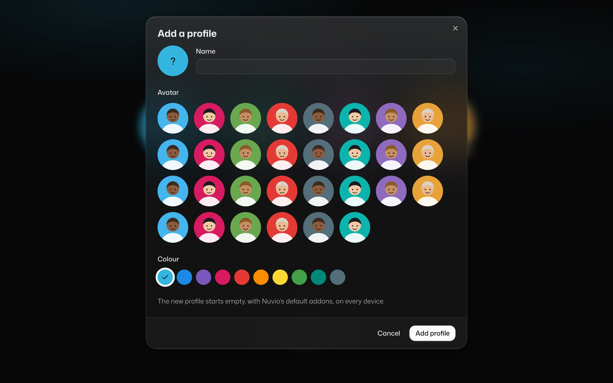 |
| Deleting says the profile goes from every device | 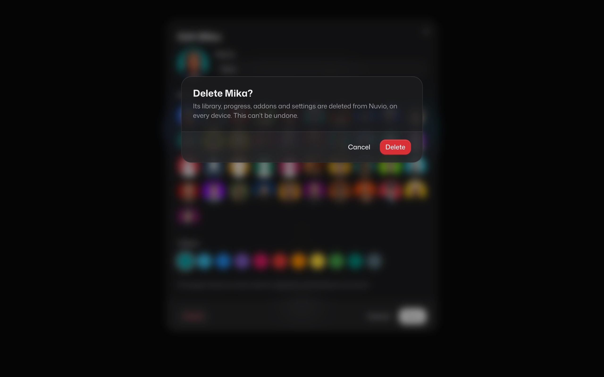 |
| Offline: the change is refused, not queued, and the editor stays open with the error up top |  |
| All six Nuvio profiles in use |  |

Colours, with the initials colour picked for contrast: `#33B5E0` (black, 8.3:1), `#1E88E5` (black, 5.4), `#7957BD` (white, 5.4), `#D81B60` (white, 4.9), `#E53935` (black, 4.7), `#FB8C00` (black, 8.3), `#FDD835` (black, 14.2), `#43A047` (black, 6.0), `#00897B` (black, 4.6), `#546E7A` (white, 5.4). A colour set elsewhere (Nuvio takes any) is offered first. The Guest is renamed only, and stays on the lagoon brand.

Chrome at 1280×800 (2×), with the Go services stubbed. Avatar images are Nuvio's stock avatars, from a local self-host stack's catalog.
