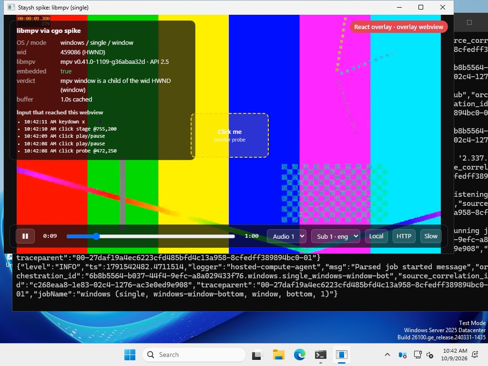
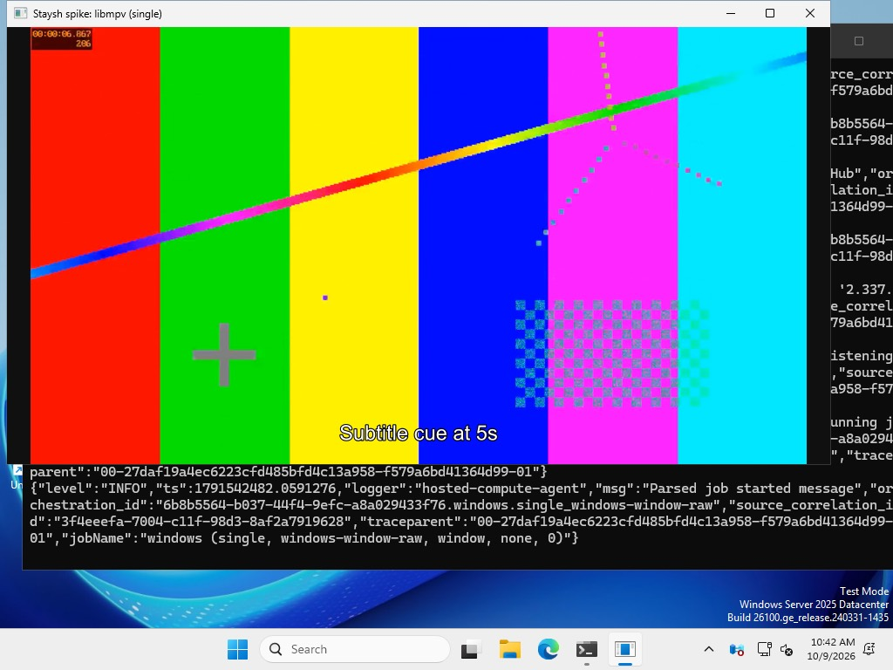
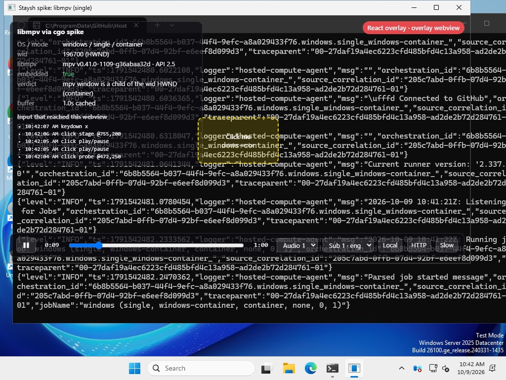
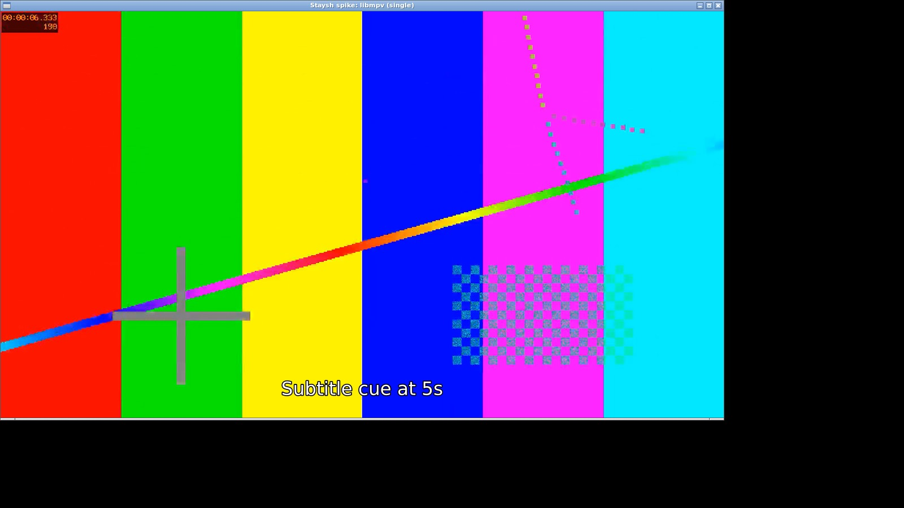
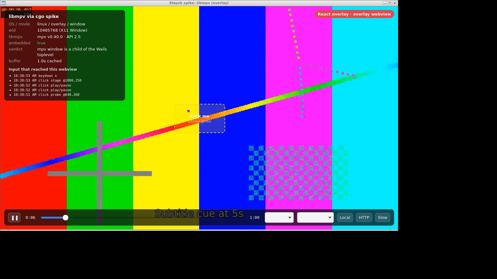
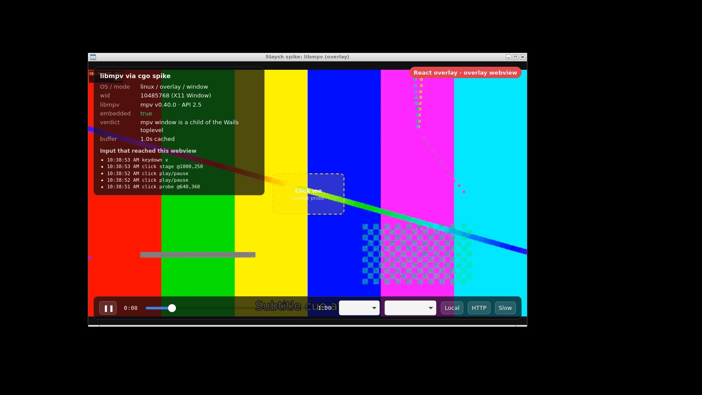

# Spike: libmpv via cgo with child-window embedding (Windows + X11)

Issue: [#3](https://github.com/k22i/Sinag/issues/3) · Epic: [#1](https://github.com/k22i/Sinag/issues/1) · Previous spike: [mpv `--wid` + JSON IPC](mpv-wid-ipc.md) (#2) · Date: 2026-10-09
Spike code: [`spikes/libmpv-cgo/`](../../spikes/libmpv-cgo/) (throwaway). Raw results: [`spikes/libmpv-cgo/results/`](../../spikes/libmpv-cgo/results/).

## Verdict

**Works on Windows and Linux X11.** Linking libmpv in-process through cgo and embedding its video window with `wid` gives the same picture as the child process in #2. It's simpler to run and faster to talk to.

- **Windows: works, in a single window.** Transparent WebView2 over mpv's child HWND, with clicks and keys reaching React. As in #2, mpv's HWND has to go to the bottom of the z-order, or we use WebView2 composition hosting. With libmpv, mpv's window was created on top of WebView2's in every run, so this fix is required, not just a safeguard against a race.
- **Linux X11: works, with a second transparent overlay window** for the UI, exactly as in #2. An X11 child window always paints over the GTK content.
- **Events to React:** `time`, `tracks`, `buffering` and `ended` all arrive. The Go↔mpv hop is sub-millisecond. The Go→React bridge costs ~1 ms when the machine is idle. On a 2-vCPU, GPU-less CI runner that is busy decoding and rendering video in software, it rises to tens of ms.
- **cgo is cheap to adopt.** The Windows build cross-compiles from Linux with mingw-w64, and a stock Windows runner also builds it natively. Linux already needed cgo for GTK.

**Recommendation for v1:** use **libmpv on every OS rather than the child process**. On Windows and X11 it does everything the child process did with fewer moving parts. On macOS and Wayland, #4's render API needs libmpv anyway, so one library and one Go binding serve all platforms. What's still open for #8 is whether Windows/X11 keep `wid` embedding or move to the render API too. The two things to settle first are **GPL licensing** and the **loss of crash isolation**. [Details at the end.](#recommendation-per-os-for-v1)

## Results matrix

| | Embedded in app window | React overlay visible over video | Input reaches overlay | Events to React (`time` / `tracks` / `buffering` / `ended`) | Local + HTTP + throttled stream |
|---|---|---|---|---|---|
| **Windows** (Server 2025, WebView2, libmpv 0.41.0-git) | ✅ child HWND | ✅ same window, with mpv's HWND at `HWND_BOTTOM` or composition hosting. ❌ if left as created | ✅ clicks on controls, on the probe and on empty video area; keys | ✅ | ✅ (plus a public HTTPS URL) |
| **Linux X11** (GTK 4.18 / WebKitGTK 2.54, libmpv 0.40.0) | ✅ child X window | ⚠️ only with a 2nd transparent overlay window. In one window the video covers the UI | ✅ clicks + keys (with `input-cursor-passthrough`) | ✅ | ✅ |
| macOS, Wayland | not tested: `wid` is unsupported there (#2), so these go to the render API (#4) | | | | |

✅ works · ⚠️ works with caveats · ❌ fails

### How this was tested (read before trusting the numbers)

- **Windows:** GitHub-hosted `windows-2025` runners, **2 vCPUs, no GPU** (D3D11 on the Microsoft Basic Render Driver, software decoding), two full runs of the [workflow](../../.github/workflows/spike-libmpv-cgo.yml). The exe was cross-compiled on Ubuntu with mingw-w64. libmpv is [shinchiro's build](https://github.com/shinchiro/mpv-winbuild-cmake/releases/tag/20261009) `20261009` (mpv v0.41.0-1109-g36abaa32d), because official mpv releases ship no libmpv for Windows.
- **Linux:** headless in Docker on arm64 (Debian trixie, 6 cores), Xvfb + openbox + picom, llvmpipe software GL, Debian's `libmpv2` 0.40.0. This isn't a real desktop.
- **Self-test** (`SPIKE_SELFTEST`): play a local file, check `duration` / `track-list` / `vo-configured`, then pause/resume ×5, seek, `aid` switch, and seek to the end for `ended`. After that it plays loopback HTTP, then a **throttled** loopback stream (80 KB/s against a ~130 KB/s file) to force `buffering`, and on Windows a public HTTPS URL. Then it injects clicks on the probe, the play button (twice) and an empty area of the video, plus a key press (X11 via `xdotool`, Windows via `SendInput`).
- **Latency:** Go stamps every event with the time `mpv_wait_event` returned it, and React compares that with its own clock. The Go/JS clock offset is estimated from the round trip of a bound `Ping` call (NTP-style, minimum-RTT sample). It's ~1–2 ms on Linux. On the loaded Windows runner it varies by up to ±40 ms, because call RTTs there are 50–100 ms. **So the Windows numbers below that were taken during playback are only good to a few tens of ms.**

## Per OS

### Windows: works in a single window, once mpv's HWND is pushed down

We pass the Wails top-level HWND to `mpv_set_option(…, "wid", MPV_FORMAT_INT64, …)`. In-process, the full 64-bit handle goes straight into the option, with no `uint32` truncation as on #2's command line. mpv's VO thread creates its own child window (class `mpv`) under it. All self-test steps passed in every variant, in both runs, and the process exited cleanly (exit code 0).

| Variant | Result (2 runs each) |
|---|---|
| `window-raw`: wid = Wails HWND, mpv's window left as created | ❌ **Video covers the UI** in both runs. With libmpv, mpv creates its window when the first file loads, after WebView2's, so it's always topmost. Clicks still reached the webview (`WindowFromPoint` → `Chrome_RenderWidgetHostHWND`). |
| `window-bottom`: as above, then `SetWindowPos(mpv, HWND_BOTTOM)` + `EnableWindow(mpv, FALSE)` | ✅ Transparent React UI over the video. Probe, play button, empty-area click and key all reached React. |
| `composition`: Wails `WebView2CompositionHosting: true`, mpv's window untouched | ✅ Same as `window-bottom`. Hit-tests land on the Wails HWND, which forwards input to WebView2. |
| `container`: wid = our own disabled `STATIC` child HWND, created at `HWND_BOTTOM` before mpv starts (with and without `WS_CLIPCHILDREN`) | ❌ **Nothing visible**, neither the video nor the container's own black fill: the desktop shows through. UI and input work. Wails makes transparent windows with `WS_EX_NOREDIRECTIONBITMAP`, so GDI content in the window is never composited. That explains the missing fill. Why mpv's flip-model swapchain also disappears one level down, when it rendered fine as a direct child, we didn't establish (hypothesis: no DWM surface for a grandchild under a no-redirection-bitmap parent). Dropped, since the two variants above work. |

| mpv HWND at the bottom (`window-bottom`) | Composition hosting |
|---|---|
|  |  |

| Raw: mpv's window on top, UI hidden | Container HWND: video invisible |
|---|---|
|  |  |

(The runner's console window shows through behind the app; that's the runner, not the app.)
The container without `WS_CLIPCHILDREN` (run 1) looked the same: [screenshot](libmpv-cgo/windows-container-noclipchildren-run1.jpg).

### Linux X11: works, with a second window for the overlay

Same as #2 in every respect that matters. mpv's window is a child of the GTK4 toplevel (`window-id`'s parent from `XQueryTree` is the Wails XID). In one window the video covers the UI, though input still reaches the webview. A frameless, transparent overlay window that is transient-for the main window shows the React UI over the video, receives the clicks (probe, play ×2, empty area) and key, and follows a move + resize.

| Single window: UI hidden under the video | Overlay window | Overlay after move + resize |
|---|---|---|
|  |  |  |

**New on Linux: libmpv refuses to start under a non-English locale.** GTK calls `setlocale(LC_ALL, "")` at startup. With `LC_ALL=de_DE.UTF-8`, `mpv_create()` printed `Non-C locale detected. This is not supported.` and returned NULL ([result](../../spikes/libmpv-cgo/results/linux-x11-locale-unfixed.json)). Calling `setlocale(LC_NUMERIC, "C")` on the GTK thread before `mpv_create` fixes it ([result](../../spikes/libmpv-cgo/results/linux-x11-locale-fixed.json)). A child process never hit this, because mpv set its own locale.

## The binding and the events

[`mpv.go`](../../spikes/libmpv-cgo/mpv.go) is ~300 lines of cgo: `mpv_create`, `mpv_set_option(_string)`, `mpv_initialize`, `mpv_command`, `mpv_set_property_string`, `mpv_get_property(_string)`, `mpv_observe_property`, `mpv_request_log_messages`, `mpv_wait_event`, `mpv_wakeup`, `mpv_terminate_destroy`, plus `mpv_node` → Go value conversion. Rules it follows:

- **One goroutine owns `mpv_wait_event`.** It blocks inside C, which ties up one OS thread; that's fine. Everything it gets is copied into Go values before the next call, because libmpv reuses the event memory.
- **Shutdown:** set a flag, call `mpv_wakeup`, wait for the loop to exit, *then* `mpv_terminate_destroy` under a write lock that every other call takes for reading. Every run exited cleanly with no hang.
- We never call libmpv from the UI thread (`InvokeSync`). mpv's window belongs to its VO thread but is a child of the UI thread's window, so a synchronous call from the UI thread while the VO thread is messaging its parent looks like a deadlock risk. **We followed this as a precaution and didn't test it.**

The event loop turns mpv events into Wails events, each carrying `ts` (Go µs):

| Wails event | From | Payload |
|---|---|---|
| `player:time` | `time-pos`, `duration` changes | `{pos, duration}`, ~30/s while playing (every frame) |
| `player:tracks` | `track-list` (`MPV_FORMAT_NODE`) | `{tracks}` |
| `player:buffering` | `paused-for-cache`, `cache-buffering-state`, `demuxer-cache-duration`, `seeking` | `{buffering, percent, cacheSecs, seeking}` |
| `player:ended` | `MPV_EVENT_END_FILE` | `{reason: eof/stop/error/…, error}` |
| `player:state` | everything else observed (`pause`, `path`, `hwdec-current`, …) | `{name, value}` |

React received every type in every run. The throttled stream produced `buffering: true` ~1.6–2.1 s after load and recovered ~1.7–1.9 s later. Playing to the end produced `ended` with reason `eof`. Each `loadfile` that replaced a file produced one with reason `stop`.

### Latency

All values in ms, p50 / p95, across the runs listed. "Ticks" are 90 synthetic events at 30 Hz sent through the same `Emit` path. They measure the Go→React bridge alone, once while mpv is paused and once while it plays.

| | Linux X11 (Docker, 6 cores) | Windows (CI, 2 vCPU, no GPU) |
|---|---|---|
| `mpv_command` → property-change in Go (`set pause`) | **0.2–0.3 / ≤ 1.5** | 29–62 / 40–163 |
| Go → React, ticks while paused | 1.6–1.9 / 3.8–4.6 | **0.5–0.9 / 1.1–2.7** (4 of 5 variants; composition's clock offset was off by a few ms) |
| Go → React, ticks while playing | 0.8–1.0 / 3.2–3.7 | 11–71 / 44–133 |
| Go → React, `player:time` | 0.8–1.0 / 1.9–2.1 | 32–59 / 84–170 |
| React → Go → React bound-call round trip | 2 (p50) | 48–109 (p50) |
| Click on the React play button → React sees the new `pause` | 2–5 (2 samples per run) | 15–282 (2 samples per run) |
| Events emitted before the page loaded | delivered ≤ 0.2 s late | **delivered 3–7 s late** |

What this says:

- **Transport to mpv is not the bottleneck.** In-process, mpv answers a command in well under a millisecond on Linux. #2's IPC numbers were limited by 25 ms polling, so we can't compare the two precisely. Either way, the costs that matter sit elsewhere.
- **The Wails event bridge is fast when the machine is idle** (~1 ms on both OSes). On the Windows runner, everything got slower during playback: the bridge, mpv's own command handling, and bound calls. That's what you'd expect from 2 vCPUs software-decoding and software-rendering 720p30 while also compositing WebView2. **Real-hardware numbers belong to #7.** Until then, budget 100+ ms of UI lag on weak, GPU-less machines.
- **Events sent before React is listening are queued, not dropped**, and arrive seconds later on Windows, where WebView2 page load took 3–7 s on CI. The UI must **fetch a state snapshot on mount** rather than rely on early events.
- `player:time` at frame rate means ~30 events/s through the bridge. The UI needs about 4 Hz. **Throttle it in Go** in the real app (recommended, not tested).

### Other numbers (indicative)

| | Linux X11 (Docker) | Windows (CI) |
|---|---|---|
| `mpv_create` + options + `mpv_initialize` | 3–6 ms | 6–11 ms |
| `loadfile` → `playback-restart` (≈ first frame), local file | 290–350 ms | 1.3–2.2 s (software decode, cold) |
| same, loopback HTTP | 125–495 ms | 350–510 ms |
| App process memory while playing 720p | ~510–540 MB RSS (llvmpipe; not meaningful) | ~165 MB working set (Go + Wails + libmpv; WebView2's own processes not included) |

#2's child process needed 100–560 ms from launch to IPC connected. In-process, mpv is ready in single-digit milliseconds.

## cgo: cross-compiling, CI and packaging

- **Windows is the only platform where libmpv adds cgo.** Wails v3 on Windows is pure Go today, while Linux (GTK/WebKitGTK) and macOS (Cocoa) already need cgo. Adding libmpv means the Windows build needs a C toolchain: mingw-w64 gcc, since cgo doesn't support MSVC. We proved three ways to build it:
  - **Cross-compile on Linux** (what the workflow does): `apt install gcc-mingw-w64-x86-64`, then `CGO_ENABLED=1 GOOS=windows GOARCH=amd64 CC=x86_64-w64-mingw32-gcc` with `CGO_CFLAGS`/`CGO_LDFLAGS` pointing at the libmpv headers and import library. Builds in ~10 s on `ubuntu-24.04`. The exe imports only `KERNEL32.dll`, `msvcrt.dll` and `libmpv-2.dll`, with no `libgcc`/`libwinpthread` DLLs to ship, and it ran on the Windows runners.
  - **Native on `windows-2025`**: works out of the box, since gcc is preinstalled at `C:\mingw64` (16–70 s, mostly module downloads).
  - **zig** (`wails-cross` image, zig 0.14): builds with `CC="zig cc -target x86_64-windows-gnu"` once the import library is renamed `libmpv.dll.a` → `mpv.lib` (zig doesn't search the `.dll.a` name). We built it but didn't run it.
- **Build inputs:** libmpv headers plus an import library at build time (shinchiro's `mpv-dev` 7z: 31.5 MB), and `libmpv-2.dll` next to the exe at run time. shinchiro publishes **daily git builds** and prunes old ones, so we must pin a version and mirror it, or build our own (#77).
- **Linux:** add `libmpv-dev` and `#cgo pkg-config: mpv`. Cross-arch builds need a target sysroot for GTK, WebKitGTK *and* libmpv. That was already true without libmpv, so the simplest route is native runners per architecture. The `.deb` can depend on the distro's `libmpv2`. AppImage and Flatpak need libmpv bundled (#79).
- **macOS** (not tested here, relevant to #4/#78): Homebrew's libmpv isn't relocatable (dozens of dylibs with absolute paths). We'll need a self-contained libmpv build to bundle and sign.
- **`libmpv-2.dll` is big and has a hard dependency on `vulkan-1.dll`.** shinchiro's "everything" build is 121 MB uncompressed (LuaJIT, JavaScript, VapourSynth, shaderc, …); #2's `mpv.exe` was 57 MB. It also imports `vulkan-1.dll` directly, not delay-loaded. The runner has it, as does any PC with current GPU drivers. On a machine without the Vulkan loader, though, the app **would fail to start at all**: an inference from the import table, not tested. Fix that with a trimmed libmpv build of our own (smaller, Vulkan optional), or by bundling the Vulkan loader. That's for #77 and #88.
- **Licensing:** both libmpv builds we used are GPL. shinchiro's lists `gpl` among its features, and Debian's builds with mpv's default `gpl=true`. Linking a GPL libmpv into our process makes the app a combined work, so Sinag would have to ship under GPL-compatible terms. mpv can be built LGPL (`-Dgpl=false`, with an LGPL FFmpeg), which drops some features. A separate mpv process is usually argued to avoid this. **Not legal advice. Decide at #8, before the repo gets a license.**

## Gotchas (what the real app must handle)

1. **Set `LC_NUMERIC` to `"C"` before `mpv_create` on Linux** (on the GTK thread, after GTK has initialised), or libmpv refuses to start on non-English desktops.
2. **Windows: mpv's window starts on top of WebView2.** Push it to `HWND_BOTTOM` (and disable it) once it exists, or use `WebView2CompositionHosting`. Re-assert after a VO re-init, which recreates the window (untested). A container HWND does **not** work inside Wails' transparent (`WS_EX_NOREDIRECTIONBITMAP`) window.
3. **X11: the UI needs the overlay window**, plus `input-cursor-passthrough=yes` on mpv. Both carry over unchanged from #2.
4. **Wails queues events emitted before the page has loaded and delivers them late.** Fetch a state snapshot when React mounts.
5. **Only one goroutine may call `mpv_wait_event`, and `mpv_terminate_destroy` must not race with anything.** Stop the loop with `mpv_wakeup` first.
6. **Throttle `time-pos` before emitting it.** At frame rate it's ~30 events/s per window.
7. Still from #2: pin the VO/GPU context and check `vo-configured`, since mpv silently falls back to `vo=sdl`, which ignores `wid`, when GPU probing fails. Wait for a real native handle before setting `wid` (`wid=0` draws on the desktop).
8. Noise, not a bug: on GPU-less Windows, `hwdec=auto-safe` logs `AVHWFramesContext: Error creating an internal frame pool` and falls back to software decoding.

**Gone compared with #2:** orphaned mpv processes (playback dies with the app), named-pipe/socket handling, the 100–560 ms process launch, and the `uint32` truncation of `--wid` on Windows.
**Lost compared with #2: crash isolation.** A crash inside libmpv or FFmpeg, for example on a malformed stream, now takes the whole app down, where a child process could simply be restarted. Not tested.

## Recommendation per OS for v1

| | Child process (`--wid` + IPC, #2) | libmpv via cgo (`wid`, this spike) | v1 pick |
|---|---|---|---|
| **Windows** | ✅ works (HWND at bottom) | ✅ works (HWND at bottom, or composition hosting) | **libmpv.** Same visual result; no process to babysit, no pipe, in-process events; cgo via mingw is cheap. |
| **Linux X11** | ✅ with overlay window | ✅ with overlay window | **libmpv.** Same reasoning, plus the `LC_NUMERIC` fix. |
| **macOS** | ❌ | ❌ via `wid`; needs the render API | **libmpv render API (#4).** |
| **Linux Wayland** | ❌ (XWayland only) | ❌ via `wid`; needs the render API | **libmpv render API (#4).** |

1. **Adopt libmpv as the playback library everywhere.** The render API (#4) is part of libmpv, so macOS and Wayland need libmpv regardless. Using it on Windows and X11 too gives one dependency and one Go binding, and no second IPC-based path to maintain. The command/property/event model is the one #2 recommended keeping, so the Go player interface and the React side carry over unchanged.
2. **#8 decides how video reaches the window on Windows and X11:** keep `wid` embedding (proven here; costs the z-order fix on Windows and an overlay window on X11), or use the render API everywhere if #4 shows it composes cleanly with WebView2/WebKitGTK. On X11 the render API would remove the overlay window, which is the weakest part of this approach.
3. **Settle before M1:** the GPL question (or an LGPL libmpv build), our own trimmed libmpv build per platform (size, Vulkan dependency, version pinning), and whether losing crash isolation is acceptable for a streaming client that will meet malformed streams.

## Open risks / not covered

- No real GPU: hardware decoding, HDR, tearing, and overlay flicker during playback weren't exercised. Windows latency was measured on a starved 2-vCPU runner.
- VO re-init (e.g. changing `vo` or the GPU context at runtime) recreating mpv's HWND and breaking the z-order fix wasn't tested. Neither were fullscreen, DPI scaling, or multi-monitor moves.
- Crash isolation: what happens to the app when libmpv crashes wasn't tested.
- The calling-libmpv-from-the-UI-thread deadlock risk was avoided, not tested.
- Windows ARM64, Windows 10/11 desktops (vs Server 2025), real GNOME/KDE, and XWayland weren't tested. The zig-built exe wasn't run.
- A machine without `vulkan-1.dll` wasn't tested.

## Reproduce

See [`spikes/libmpv-cgo/README.md`](../../spikes/libmpv-cgo/README.md). In short: `scripts/make-media.sh`, build the frontend, then:

- Linux: `docker build -t sinag-spike-libmpv scripts/linux && docker run --rm -v "$PWD":/spike sinag-spike-libmpv scripts/linux/run.sh single` (or `overlay`; `LC_ALL=de_DE.UTF-8 SPIKE_KEEP_LOCALE=1 … single locale-unfixed` for the locale failure)
- Windows: run the `spike-libmpv-cgo` workflow (runs [37918032020](https://github.com/k22i/Sinag/actions/runs/37918032020) and [37918970157](https://github.com/k22i/Sinag/actions/runs/37918970157)). Files in `results/` ending in `-run1` come from the first run, which predates the before-ready/tick instrumentation and `WS_CLIPCHILDREN` on the container.
