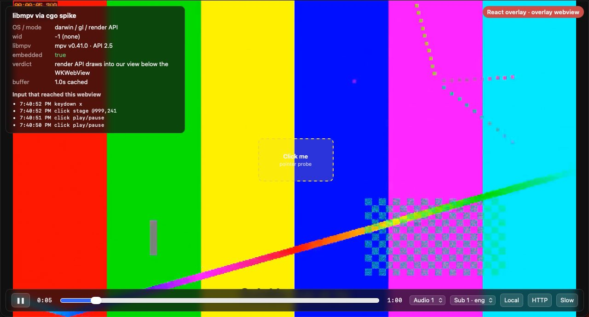
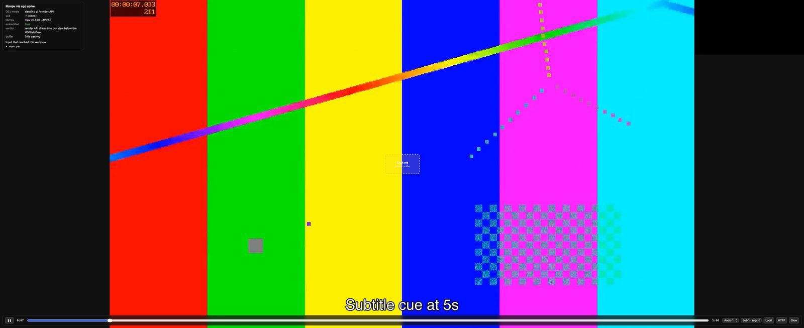
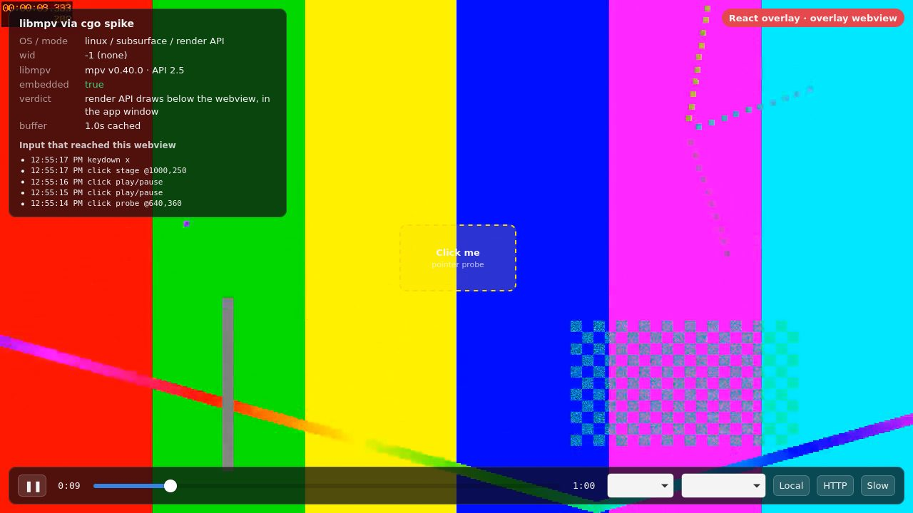
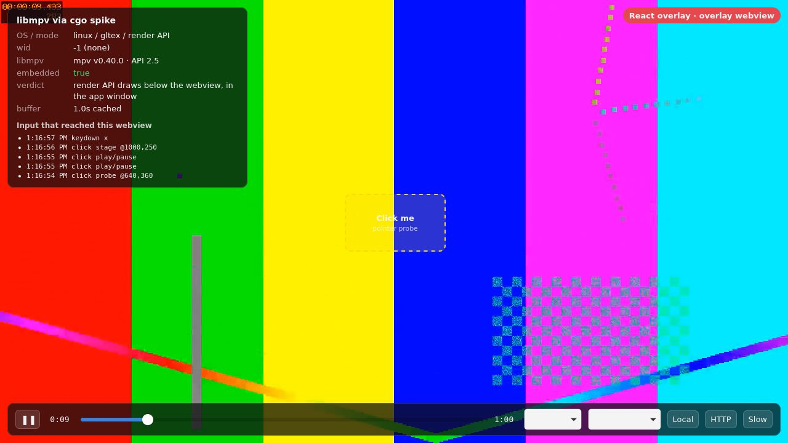
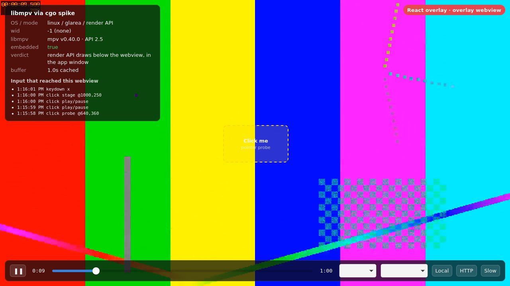
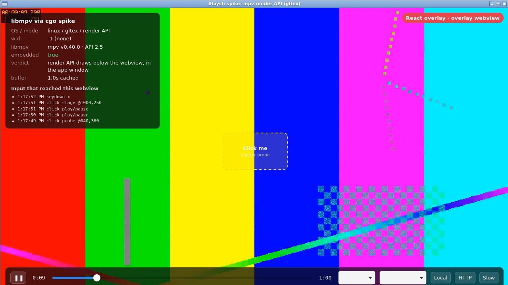
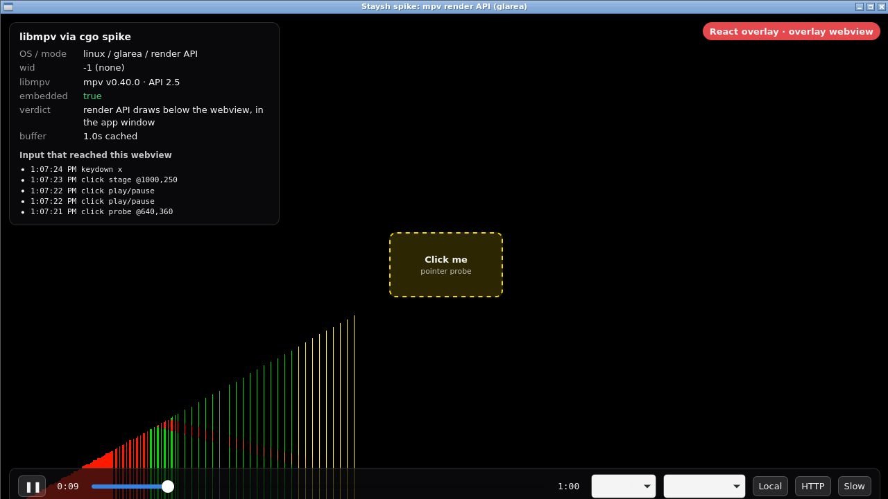
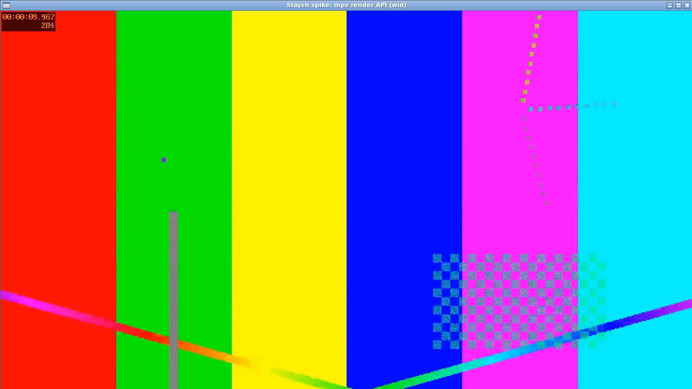

# Spike: mpv render API under the webview (macOS, Wayland, X11)

Issue: [#4](https://github.com/k22i/Peli/issues/4) · Epic: [#1](https://github.com/k22i/Peli/issues/1) · Previous spikes: [mpv `--wid` + JSON IPC](mpv-wid-ipc.md) (#2), [libmpv via cgo](libmpv-cgo.md) (#3) · Date: 2026-10-09
Spike code: [`spikes/mpv-render-api/`](../../spikes/mpv-render-api/) (throwaway). Raw results: [`spikes/mpv-render-api/results/`](../../spikes/mpv-render-api/results/).

## Verdict

**Works on macOS and on Linux Wayland, in a single window, with the React UI on top and receiving all input.** libmpv's render API (`vo=libmpv`, OpenGL) draws into a native layer or widget placed *below* Wails' transparent webview. It also works on X11, where it removes #3's second overlay window.

- **macOS: works.** We put an `NSView` whose backing layer is a `CAOpenGLLayer` under the `WKWebView`. mpv renders into it with `hwdec=videotoolbox`, at 60 fps with no drops for 1080p60, at the same CPU cost as standalone mpv. **Render on a dedicated queue, not the main thread.** The render call blocks until the frame's display time, which starved the UI thread (13.5 ms per no-op dispatch). On our own serial queue the UI thread stays at 0.04 ms. HDR10 reaches a half-float EDR layer with values above SDR white, but on-screen EDR is **unverified**: this display reports no EDR headroom.
- **Linux Wayland: works, three ways.** Video goes into a `GtkGLArea`, into textures handed to GTK from our own thread, or into our own `wl_subsurface` below GTK's surface. **Don't render on the GTK thread.** In GPU-less containers it starved Wails' main-thread dispatch, for up to 176 s on X11. Both off-thread hosts keep the UI responsive.
- **Linux X11: works in one window** with the GTK texture host. That removes #3's transparent overlay window and its window-manager dependence. In GPU-less containers it costs ~1.8× the CPU of #3's `wid` + overlay (491% vs 268% of a core), because GTK composites the video in software GL. **Real-GPU cost is unmeasured (#7).**
- **React overlay: works everywhere.** Clicks on controls, on the probe and on empty video area, plus keys, reached React in every mode on every OS. `time`, `tracks`, `buffering` and `ended` events arrive as in #3.

**Recommendation for v1:** use libmpv everywhere (as #3 recommended). Use the render API on macOS (`CAOpenGLLayer`, drawn from our own queue). On Linux, use it from a render thread through GTK textures, on both X11 and Wayland. Windows stays on #3's `wid`: libmpv's render API offers only OpenGL and software, with no Direct3D. So "one render-API path everywhere" isn't on offer, but one binding, one threading model and a ~300-line native host per OS is. [Details at the end.](#recommendation-for-8)

## Results matrix

| | Video below the webview, one window | React UI visible over video | Input reaches React | Resize / fullscreen follow | Off the UI thread |
|---|---|---|---|---|---|
| **macOS** `gl` (`CAOpenGLLayer`, 27.0.1, M1 Pro) | ✅ | ✅ | ✅ (5/5 probes; one run lost the first click, see [gotcha 6](#gotchas-what-the-real-app-must-handle)) | ✅ / ✅ | ✅ with `SPIKE_GL_THREAD` (our queue). ❌ default (main thread) |
| macOS `sw` (software render API) | ✅ | ✅ | ✅ | ✅ / ✅ | ✅ (but ~3× CPU) |
| **Wayland** `subsurface` (own `wl_subsurface`) | ✅ | ✅ | ✅ | ✅ / ✅ | ✅ |
| **Wayland / X11** `gltex` (`GdkGLTexture` from our thread) | ✅ | ✅ | ✅ | ✅ / ✅ | ✅ (GTK still composites) |
| Wayland / X11 `glarea` (`GtkGLArea`) | ✅ | ✅ | ✅ (⚠️ X11: 0/5 in one run, UI thread starved) | ✅ / ✅ | ❌ renders on the GTK thread |
| Wayland / X11 `sw` | ✅ | ✅ | ✅ | ✅ / ✅ | ✅ |
| *X11 `wid` (#3 baseline)* | ❌ video covers the UI | ❌ | ✅ | ✅ / ✅ | n/a |
| *X11 `overlay` (#3 as shipped)* | ⚠️ needs a second window | ✅ | ✅ | ✅ / ✅ | n/a |

✅ works · ⚠️ works with caveats · ❌ fails

### How this was tested (read before trusting the numbers)

- **macOS:** this Mac (M1 Pro, 8 cores, macOS 27.0.1, 3840×1600 @ 144 Hz external display), Homebrew mpv/libmpv **0.41.0**, OpenGL 4.1 on Metal. Window 1280×720. Screenshots via `screencapture`, input as in-process `NSEvent`s sent through `-[NSWindow sendEvent:]`, so they get the window's real hit-testing. **The machine was in use during the runs.** Machine-wide numbers (WindowServer CPU, GPU utilisation) were dominated by other activity, so we draw no conclusions from them (see below).
- **Linux:** headless in Docker on arm64 (Debian trixie, 6 cores), GTK 4.18.6, WebKitGTK 2.54.0, Debian's libmpv **0.40.0**, **llvmpipe software GL, no GPU**. Wayland is sway 1.10.1 (wlroots) on its headless backend with the pixman renderer. X11 is Xvfb + openbox + picom, as in #2/#3. Input on Wayland comes from [`vinput`](../../spikes/mpv-render-api/scripts/linux/vinput/vinput.c), a small client that keeps a virtual pointer and keyboard alive (`wlrctl`/`wtype` remove their device before GTK binds it). X11 input comes from `xdotool`. These aren't real desktops, and with software GL every "GPU" cost is CPU.
- **Self-test** (`SPIKE_SELFTEST`): #3's steps (play, observe, pause ×5, seek, `aid` switch, `ended`, loopback HTTP, throttled stream for `buffering`). Then resize to 960×540 and back, fullscreen and back, and on macOS minimise for 3 s and an HDR10 clip. Then the **bench**, then the input probes (probe, play button ×2, empty video area, key).
- **Bench:** 10 s of steady playback after a 2 s warm-up, preceded by a 4 s paused baseline. It measures CPU of our process, its WebKit processes and the display server/compositor (% of one core). It also measures **UI-thread latency**: every 50 ms, how long a no-op `InvokeSync` takes, which shows when rendering on that thread starves the app. Frame pacing is the interval between renders of new frames. mpv's drop counters complete the picture. Clips: **macOS 1080p60 H.264** (VideoToolbox), **Linux 720p30 H.264** (software decode, as in #3).
- GL timer queries return 0 on Apple's GL, and on llvmpipe they don't measure anything meaningful. So there is no GPU time per frame in this doc.

## macOS: works; draw from your own queue

The host ([`video_darwin.m`](../../spikes/mpv-render-api/video_darwin.m)) finds the `WKWebView` in the window's content view. It inserts our `NSView` directly below it (`addSubview:positioned:NSWindowBelow relativeTo:webView`), autoresizing with it. The view's `hitTest:` returns `nil`. Its backing layer is a `CAOpenGLLayer` that creates a CGL context, and mpv's render context with it (`MPV_RENDER_API_TYPE_OPENGL`), before the first `loadfile`. mpv's update callback schedules a redraw. In `drawInCGLContext:` we call `mpv_render_context_render` on the layer's FBO, then `mpv_render_context_report_swap`. Like mpv's own `cocoa-cb` backend, we hand mpv a no-op `glFlush`. Every input probe hit-tested to the `WKWebView` and reached React. The React panels' `backdrop-filter` tints the video below.

| Video under the `WKWebView`, input reached React | Fullscreen (the window fills the screen below the menu bar) |
|---|---|
|  |  |

**Wails gotcha:** with `Mac.Backdrop: MacBackdropTransparent`, beta.28 still left the webview with `drawsBackground = YES`, so a white page covered the video. We set it ourselves after the window exists (`[webView setValue:@NO forKey:@"drawsBackground"]`, the same private key Wails uses).

### Threading: who calls render, and does it block?

By default `mpv_render_context_render` **blocks until the frame's target display time** (`MPV_RENDER_PARAM_BLOCK_FOR_TARGET_TIME`). Whatever thread draws the layer waits there almost a whole frame. We compared four ways of driving the layer (1080p60, 10 s, the window visible and active):

| Variant | Draws on | UI thread (`InvokeSync` no-op) p50 / p95 ms | Frame interval p50 / p95 ms (σ, late) | Render call p50 ms | App CPU % | While minimised 3 s | After restore |
|---|---|---|---|---|---|---|---|
| `gl`: `setNeedsDisplay`, blocking (mpv's `cocoa-cb` model) | main | **13.5 / 17.4** | 16.7 / 20.2 (2.6, 3 late) | 15.8 | 22.0 | 68 VO drops, clock runs | back within 2 s |
| `gl` + `SPIKE_NO_BLOCK` | main | 0.04 / 1.7 | 16.7 / 19.7 (1.8, 0) | 0.9 | 20.9 | 67 drops, clock runs | **4.5–5 s** to 30 frames |
| `gl` + `SPIKE_GL_ASYNC` (`asynchronous` layer) | main (!) | 0.05 / 12.5 | 16.7 / 17.3 (1.7, 5) | 11.7 | 21.8 | **playback froze** (clock stopped) | 31 frames in the first 2 s |
| **`gl` + `SPIKE_GL_THREAD`** (`display` on our serial queue, like IINA) | **our queue** | **0.04 / 0.11** | **16.5 / 19.4 (1.6, 0)** | 16.2 | 21.1 | 55 drops, clock runs | **0.47 s** |
| `sw` (software render API → `CALayer.contents`) | our thread | 0.04 / 1.8 | 16.6 / 21.5 (3.1, 1) | 16.6 | **64.7** (`videotoolbox-copy`) | playback slowed (1.4 s in 3 s) | no frames in the first 2 s |

All variants played 60 fps with no decoder or VO drops while visible. "Late" counts intervals above 1.5× the frame time; at 60 fps on a 144 Hz display they quantise to 13.9/20.8 ms.

- **Rendering on the main thread blocks the app's UI thread for ~14 ms of every 16.7 ms frame.** That's Cocoa event handling, Wails' main-thread dispatch, menus and window drags. Turning blocking off fixes the latency but makes rendering timing-fragile: after a restore it took 4.5–5 s (two reruns) to get back to a full frame rate.
- **`asynchronous = YES` doesn't move drawing off the main thread** on macOS 27, and it froze playback entirely while the window was hidden.
- **Calling `-[CAOpenGLLayer display]` on our own serial queue inside an explicit `CATransaction`** (IINA's approach) gives the best of both. mpv blocks *our* thread for frame timing, the UI thread is untouched (0.11 ms p95), pacing is the tightest, and it resumes in under half a second after the window comes back. The CGL context lock serialises it with the resize redraws AppKit still does on the main thread.

**What the render API costs:** the same 1080p60 clip in the **mpv binary itself**, own window, `hwdec=auto-safe`, used **20.7%** CPU with `vo=gpu-next` (Metal via MoltenVK) and **18.0%** with `vo=libmpv` (mpv's own `CAOpenGLLayer` render-API path). Our whole app used **21.1%** (`gl-thread`), which includes Go, Wails and the React event bridge. The WebKit processes added ~10% (WebContent ~7%, GPU ~3.5%), because React re-renders on every `player:time` event (60/s here; #3 already says to throttle). WindowServer CPU and GPU "Device Utilization %" are machine-wide. Their *paused* baselines on this busy machine ranged 11–60% and 19–73% between runs, so their deltas are noise. Real baselines belong to #7.

### When the window can't be seen

Core Animation doesn't draw layers of occluded or minimised windows. mpv's VO then waits up to 200 ms per frame for a render that never comes. It logs `mpv_render_context_render() not being called or stuck`, drops the frame, and audio keeps the clock running ([numbers above](#threading-who-calls-render-and-does-it-block)). That's fine, as long as rendering resumes promptly (the `gl-thread` variant: 0.47 s). Two things bit us while measuring:

- Launched from a terminal, the app sometimes started **behind** other windows (macOS's cooperative activation ignores `activateIgnoringOtherApps:`). The window was then occluded and nothing was drawn for the whole run. The bench now records window visibility, and the run script flags hidden runs. One such run was discarded.
- In `sw` mode, and once in the default mode while the app was inactive, playback itself slowed or stalled while hidden. That's consistent with **App Nap** throttling the process, but untested. A media player should hold an `NSProcessInfo` activity (`beginActivityWithOptions:`) while playing.

### HDR / EDR

`SPIKE_HDR=pq|linear` sets up the layer like mpv's `cocoa-cb`. We use a half-float back buffer (`kCGLPFAColorFloat`, 64-bit colour, `kCAContentsFormatRGBA16Float`), `wantsExtendedDynamicRangeContent = YES`, and a colourspace on the layer: BT.2100 PQ with mpv `target-trc=pq`, `target-prim=bt.2020`, or extended-linear Display P3 with `target-trc=linear`, `target-peak=600`. We then played a 4K HDR10 clip (HEVC Main10, BT.2020/PQ, MaxCLL 1000) and read one rendered frame back from the GL back buffer:

| Layer | Read-back max | Mean | Pixels above SDR reference white | `NSScreen` EDR headroom (current / potential) |
|---|---|---|---|---|
| BT.2100 PQ | 1.00 (PQ code value, = 10 000 nits) | 0.94 | 95% | 1.0 / 1.0 |
| Extended linear P3 | **2.96** (= 600 / 203 nits) | 2.81 | 95% | 1.0 / 1.0 |

So **HDR values survive into the layer**. The test pattern is deliberately mostly highlight. But this display (an external monitor, macOS HDR not enabled for it) reports `maximumPotentialExtendedDynamicRangeColorComponentValue = 1.0`. macOS therefore tone-mapped everything to SDR, and **we couldn't see EDR engage on screen**. That needs an XDR/HDR-enabled display (#7). Two more limits: the render API is OpenGL-only, so mpv's newer `gpu-next`/Metal HDR path (`metal_layer.swift`, with `CAEDRMetadata`) isn't available to libmpv embedders. And OpenGL itself is deprecated on macOS (it still ships in macOS 27, as GL 4.1 on Metal).

## Linux Wayland: three hosts that work, one to avoid

The host ([`video_linux.c`](../../spikes/mpv-render-api/video_linux.c)) finds the `WebKitWebView` in Wails' `GtkWindow > GtkBox > WebKitWebView`. For the widget-based hosts, it swaps it at runtime for a `GtkOverlay` with the video widget as the main child and the webview as the overlay (`GtkOverlay { video, WebKitWebView }`). Reparenting a live webview worked. Wails already makes the webview background transparent. The GTK window needs #2's CSS fix (beta.28's `setTransparent()` is a stub).

- **`glarea`:** a `GtkGLArea`. mpv renders into its FBO in the `render` signal, on the GTK thread. This is the textbook GTK + libmpv recipe (Celluloid).
- **`gltex`:** a `GtkPicture`. A render thread with a `GdkGLContext` that shares with GTK's (`gdk_surface_create_gl_context`) renders each frame into one of 6 FBO-backed textures. It fences it (`glFenceSync`) and hands it to the GTK thread, which wraps it with `GdkGLTextureBuilder` (with the sync) and sets it on the picture. GTK returns the slot when it drops the texture. GTK held onto textures longer than we expected: with 3 slots, only 4 fps got through.
- **`subsurface`:** no widget at all. We bind `wl_compositor`/`wl_subcompositor` on GDK's `wl_display` (on a private event queue). We create our own `wl_surface` as a **desync `wl_subsurface` of GTK's toplevel, placed below it** with an empty input region, and render into it with EGL on our own thread. A GTK tick callback keeps it positioned under the webview. The compositor blends GTK's transparent surface over it, so GTK never touches the video.
- **`sw`:** a `GtkPicture` fed a `GdkMemoryTexture` per frame by the software render API on a render thread.

| `subsurface`: our `wl_subsurface` below GTK's surface | `gltex`: GTK textures from our thread | `glarea` |
|---|---|---|
|  |  |  |

Fullscreen, `subsurface`: [screenshot](mpv-render-api/linux-wayland-subsurface-fullscreen.jpg). All modes passed every step, followed resize and fullscreen (render target = new size within 6–74 ms), and got 5/5 input probes.

### Cost and pacing (sway headless, llvmpipe, 720p30, 10 s)

| Mode | Total CPU % (ours + WebKit + sway) | UI thread p50 / p95 / max ms | fps | Frame interval p50 / p95 ms (σ, late) | Render call p50 ms |
|---|---|---|---|---|---|
| `glarea` (redraws at idle priority) | 467 (438 + 26 + 3) | **15.2 / 22.7 / 36** | 30.0 | 32.8 / 38.3 (3.6, 4) | 25.1 |
| `glarea`, redraws at `G_PRIORITY_HIGH` | 434 | 15.5 / 18.6 / 37 | 30.0 | 33.5 / 38.5 (3.1, 0) | 25.9 |
| `gltex` | 490 (437 + 49 + 3) | 3.2 / 17.9 / 22 | 30.0 | 33.3 / 35.5 (2.1, 1) | 33.0 |
| **`subsurface`** | **335** (262 + 48 + 24) | **0.13 / 3.0 / 13** | 30.1 | 33.4 / 37.5 (2.6, 0) | 33.1 |
| `sw` | 148 (96 + 51 + 2) | 0.12 / 5.3 / 7.5 | 30.0 | 33.3 / 37.4 (2.2, 0) | 33.2 |

No decoder or VO drops in any mode. Read this with care: **with no GPU, "GL" is CPU**. That's why the software render API looks cheapest, and why every mode where GTK composites the video in GL (`glarea`, `gltex`) costs more than letting sway's pixman renderer blend a subsurface. On real GPUs the GL paths should be far cheaper and `sw` the most expensive. #7 must measure it.

What holds regardless of GPU: **`glarea` renders on the GTK thread, which is also Wails' main thread.** Every `InvokeSync`, event dispatch and window operation then waits behind mpv. Here that was ~15 ms p50. On X11 it got much worse (next section). `gltex` and `subsurface` take mpv off that thread. `subsurface` also takes GTK out of the video's path entirely.

## Linux X11: one window instead of two

The widget hosts work unchanged on X11 (`GDK_BACKEND=x11`), so the video sits under the webview in **one** window. #2/#3 needed a separate transparent overlay window there (an X child window always covers GTK's content), plus a compositor and a cooperative window manager to keep it stacked and positioned. `subsurface` is Wayland-only.

| `gltex` (one window) | `glarea`: partial frames | #3 baseline `wid`: video covers the UI |
|---|---|---|
|  |  |  |

### Cost and pacing vs `wid` (Xvfb + picom, llvmpipe, 720p30, 10 s)

| Mode | Total CPU % (ours + WebKit + Xvfb/picom) | UI thread p50 / p95 / max ms | fps | Frame interval p50 / p95 ms (σ, late) | mpv VO drops |
|---|---|---|---|---|---|
| *`wid`, single window (UI hidden)* | 264 (205 + 50 + 9) | 0.15 / 2.8 / 43 | (30) | n/a | 0 |
| ***`overlay`** (`wid` + 2nd window, #3's shippable X11 setup)* | **268** (197 + 52 + 19) | 0.15 / 3.0 / 3.7 | (30) | n/a | 0 |
| **`gltex`** | **491** (436 + 45 + 10) | 7.5 / 27.4 / 43 | 30.1 | 33.3 / 34.9 (**1.6**, 0) | 0 |
| `glarea` (redraws at idle priority) | 417 (373 + 35 + 9) | 14.2 / 31.7 / 60 | **25.1** | 38.5 / 55.5 (12.1, 74) | **49** |
| `glarea`, redraws at `G_PRIORITY_HIGH` (2 runs) | 440 | **one call stuck 176 s / 56 s** | 29.9 | 33.2 / 36.7 (2.7, 5) | 0 |
| `glarea`, high priority, non-blocking | 465 | 45.6 / 149 / 395 | 30.0 | 30.0 / 48.5 (7.7, 4) | 0 |
| `sw` | 166 (100 + 54 + 12) | 0.13 / 5.3 / 30 | 30.0 | 33.2 / 35.9 (3.2, 1) | 0 |

- **CPU: in a GPU-less container the render API (`gltex`) costs ~1.8× `wid` + overlay**: 491% vs 268%. With `wid`, mpv presents straight to its X window. With the render API, GTK composites the video texture *and* the webview every frame in software GL. On a real GPU that composite is a textured quad, so the gap should mostly close, but **that's an expectation, not a measurement (#7).**
- **Pacing:** `gltex` had the steadiest intervals of any Linux mode (σ 1.6 ms, none late). For `wid` we have no per-frame timing, only mpv's counters (0 drops, 30 fps).
- **`glarea` on X11 failed in two ways.** First, the GTK thread spent nearly every frame rendering, and Wails dispatches to the main thread with `g_idle_add` (idle priority). With our redraws scheduled above GTK's redraw priority, a single `InvokeSync` waited **176 s** (run 1, which also missed the resize check and all five input probes) and **56 s** (run 2). At idle priority the UI recovered, but video fell to 25 fps with 49 VO drops. It's zero-sum on one thread. Second, the X11 `glarea` screenshots showed **partially rendered frames** in 4 of 6 captures (above, middle). The Wayland `glarea` and every `gltex` capture didn't. That looks like a missing cross-context sync in this setup (GTK 4.18, EGL on X11, llvmpipe), but we didn't dig further.

## What carries over from #3

The binding ([`mpv.go`](../../spikes/mpv-render-api/mpv.go)) is #3's, plus one accessor. The command/property/event model, the event bridge and React's code are unchanged, and all four event types arrived in every run. New lifecycle rules for the render API:

1. **Create the render context before the first `loadfile`**, with `vo=libmpv` and **without `force-window`**. Otherwise mpv starts a VO before the context exists and falls back to one with its own window. We wait for the host to report "ready" first. It took 11–105 ms.
2. **Free it before `mpv_terminate_destroy`**, with its GL context current, on the thread that renders (our render thread, or the GTK thread for `glarea`).
3. **Never call the client API from the render thread or from the update callback.** The callback only signals: an atomic flag plus `dispatch_async`, `g_idle_add` or a condition variable.
4. Call `mpv_render_context_report_swap` after presenting. mpv's VO waits for it, up to 200 ms, before the next frame.

## Gotchas (what the real app must handle)

1. **Render off the UI thread.** By default `mpv_render_context_render` blocks until the frame's display time. On the UI thread that's ~14 ms per frame of a frozen app on macOS, and minutes-long starvation of Wails' idle-priority main-thread dispatch on Linux under load. macOS: drive `-[CAOpenGLLayer display]` from your own serial queue. Linux: render on your own thread (`gltex`/`subsurface`). Turning blocking off instead (`BLOCK_FOR_TARGET_TIME=0`) helped latency but made recovery after a hidden window slow (macOS).
2. **macOS: make the webview transparent yourself.** `MacBackdropTransparent` in beta.28 left `drawsBackground = YES`.
3. **Linux: Wails' `GtkBox > WebKitWebView` has to be rebuilt** into a `GtkOverlay` at runtime (or, for `subsurface`, left alone). The GTK window still needs #2's transparency CSS.
4. **An occluded or minimised window isn't drawn** (macOS). mpv drops video frames and keeps the clock running, and rendering must resume promptly afterwards. Hold an `NSProcessInfo` activity while playing, against App Nap (untested).
5. **`GdkGLTexture` slots:** GTK keeps the textures of the last frame or two. Use enough slots (6 worked, 3 gave 4 fps), wait for a released slot instead of dropping, and fence every frame.
6. One macOS run lost the first click of the probe sequence, probably the window-activation click (`acceptsFirstMouse`). Unrelated to video, but the real app should check its first-click behaviour.
7. Noise, not a bug: mpv logs `libmpv_render: after creating texture: OpenGL error INVALID_OPERATION.` on Apple GL and on GLES contexts. Video renders fine.
8. Test rigs: `wlrctl`/`wtype` can't drive GTK on headless sway (their devices vanish before GTK binds them), so use [`vinput`](../../spikes/mpv-render-api/scripts/linux/vinput/vinput.c). On macOS, screenshots need Screen Recording permission, and a launched app may start occluded.

## Recommendation for #8

| | `wid` (#3) | Render API (this spike) | v1 pick |
|---|---|---|---|
| **Windows** | ✅ one window (mpv's HWND at the bottom, or composition hosting) | not tested. libmpv's render API is OpenGL/software only: no D3D11, so it would need WGL or ANGLE interop with WebView2 | **`wid`** |
| **macOS** | ❌ not supported by mpv | ✅ `CAOpenGLLayer` under the `WKWebView`, drawn from our own queue | **render API** |
| **Linux Wayland** | ❌ (XWayland only) | ✅ `gltex` or `subsurface` | **render API, `gltex`** (`subsurface` as the fallback) |
| **Linux X11** | ⚠️ needs the overlay window | ✅ `gltex`, one window | **render API, `gltex`**, if #7 shows the GPU cost is acceptable. Otherwise `wid` + overlay. |

1. **macOS: render API, no alternative.** Ship the `CAOpenGLLayer` host with drawing on a dedicated serial queue. Budget for verifying HDR/EDR on a real HDR display (#7), and for OpenGL's deprecation: libmpv has no Metal render API yet.
2. **Linux: one render-API host for X11 and Wayland, rendering on our own thread: `gltex`.** It uses only public GTK API (`GdkGLTextureBuilder`, GTK ≥ 4.12), so GTK handles position, scale, fullscreen and stacking. It works the same on both sessions and had the best pacing. `subsurface` was cheaper here, because the compositor blends instead of GTK. But it's Wayland-only, hand-rolls Wayland protocol on GDK's connection, and relies on GTK's surface staying transparent above it. Keep it as the fallback if `gltex` costs too much on real GPUs. Don't use `GtkGLArea` (UI-thread rendering).
3. **This retires #3's X11 overlay window**, if the GPU cost holds up in #7. That was the weakest part of the `wid` approach (WM stacking, move/resize sync, a compositor requirement).
4. **Shared across OSes:** one Go binding, one render-context lifecycle, the same rules (render off the UI thread, signal-only callbacks, report swaps), and a ~300-line native host per OS. Windows keeps `wid`.
5. Still open from #3 and untouched here: **GPL licensing**, our own trimmed libmpv builds (macOS needs a relocatable one), and crash isolation.

## Open risks / not covered

- **No real GPU on Linux.** Every Linux CPU number includes software GL, and the X11/Wayland cost comparisons may invert on real hardware. Real GNOME/KDE, NVIDIA, fractional scaling, HiDPI buffer scale and multi-monitor weren't tested. `subsurface` was only tried on sway (wlroots).
- **macOS on one machine** with an external non-HDR display: no EDR on screen, no Retina scale factor, a 144 Hz refresh, and other apps running. Live-resize smoothness, multiple displays, Spaces and native fullscreen (Wails' fullscreen kept the menu bar) weren't checked. App Nap is a hypothesis.
- **Windows render API not tested** (see above).
- `GtkGraphicsOffload` (GTK ≥ 4.14) could let GTK itself put `gltex`'s textures in a subsurface. It needs dmabuf-backed textures, which llvmpipe can't give us, so it's untested.
- The X11 `glarea` partial frames weren't root-caused. We only established that `gltex` (explicit fences) didn't show them.
- HDR on Linux and HDR passthrough on Windows: not covered.

## Reproduce

See [`spikes/mpv-render-api/README.md`](../../spikes/mpv-render-api/README.md). In short: `scripts/make-media.sh`, build the frontend, then:

- macOS: `go build -o bin/spike .`, then `SPIKE_GL_THREAD=1 scripts/macos/run.sh gl gl-thread` (also `gl`, `sw`, `SPIKE_NO_BLOCK=1`, `SPIKE_GL_ASYNC=1`, `SPIKE_HDR=pq|linear`), and `scripts/macos/bench-mpv.sh gpu-next|libmpv` for the standalone-mpv baseline.
- Linux: `docker build -t peli-spike-render scripts/linux`, then `docker run --rm -v "$PWD":/spike peli-spike-render scripts/linux/run-all.sh` (or `scripts/linux/run.sh {wayland|x11} <mode>`).
