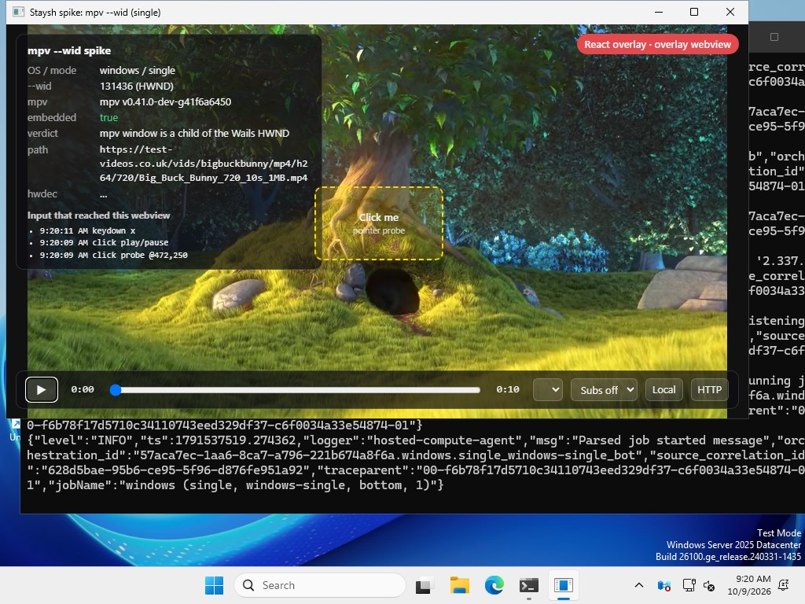
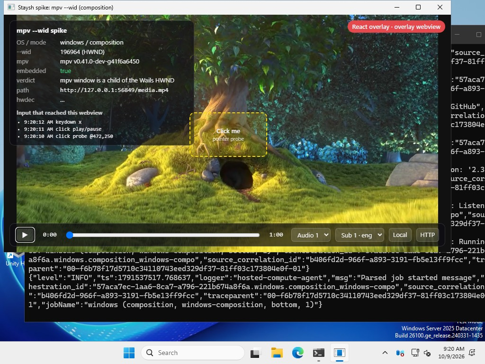
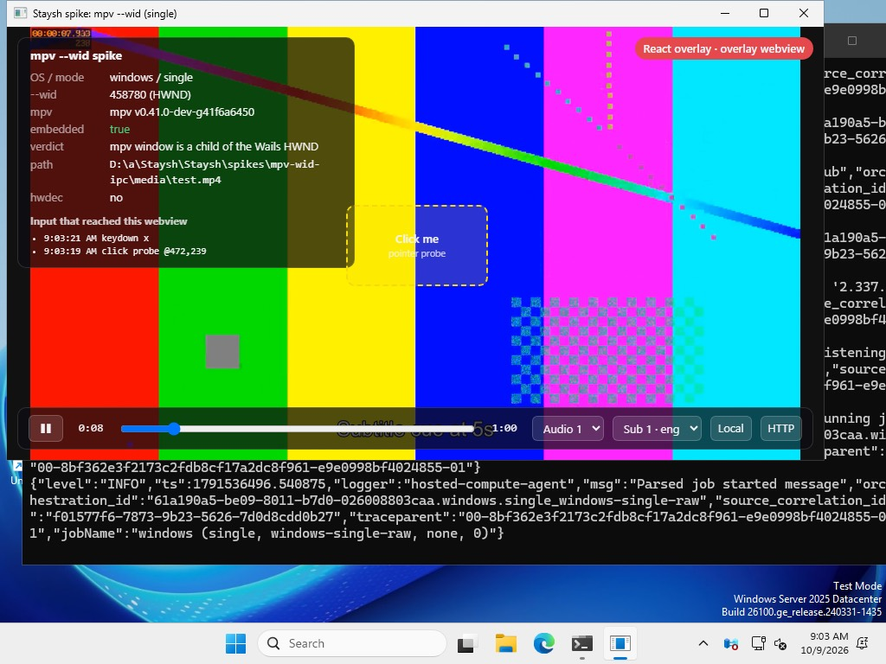
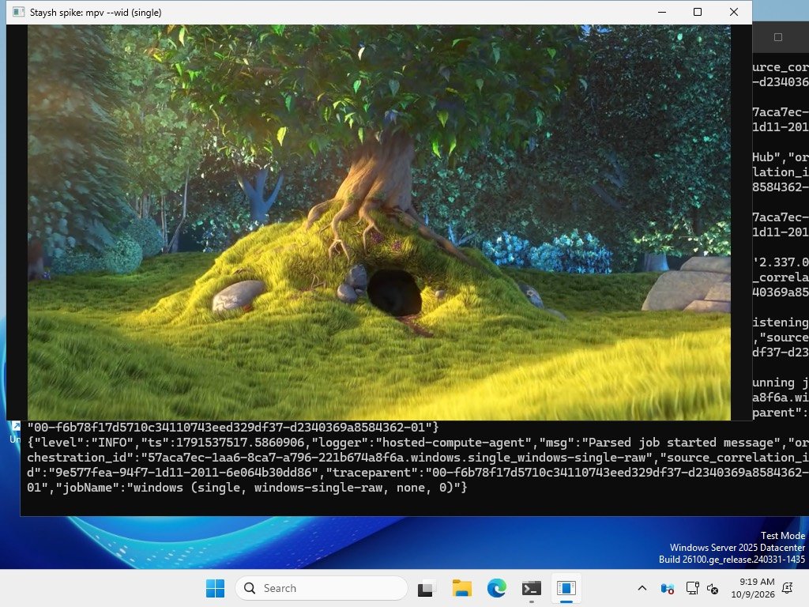
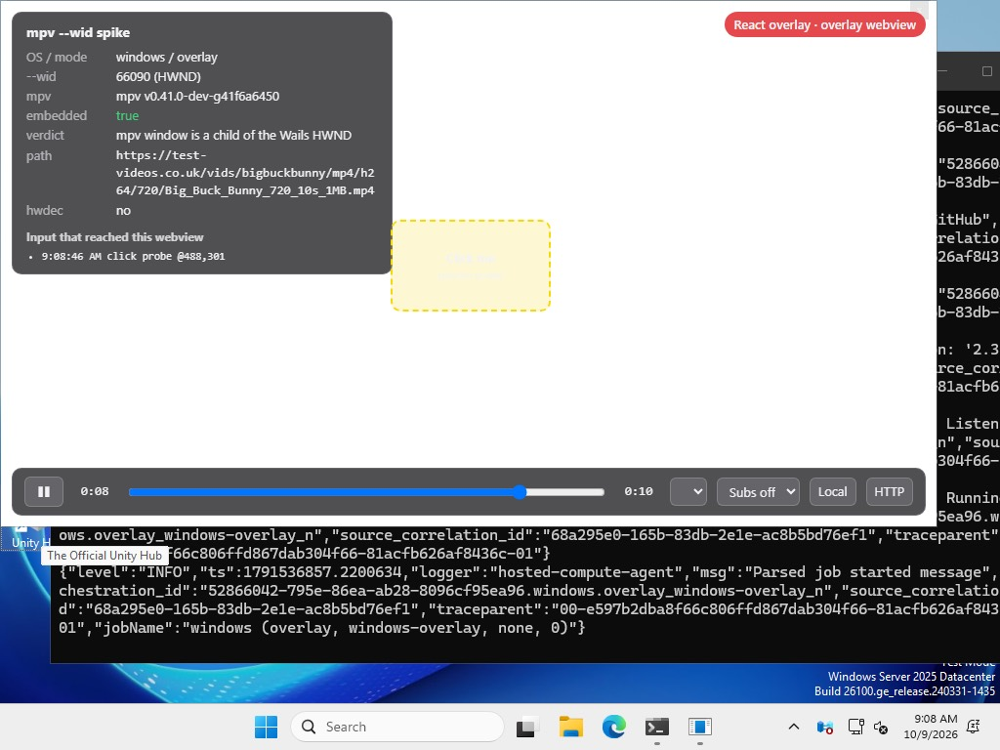
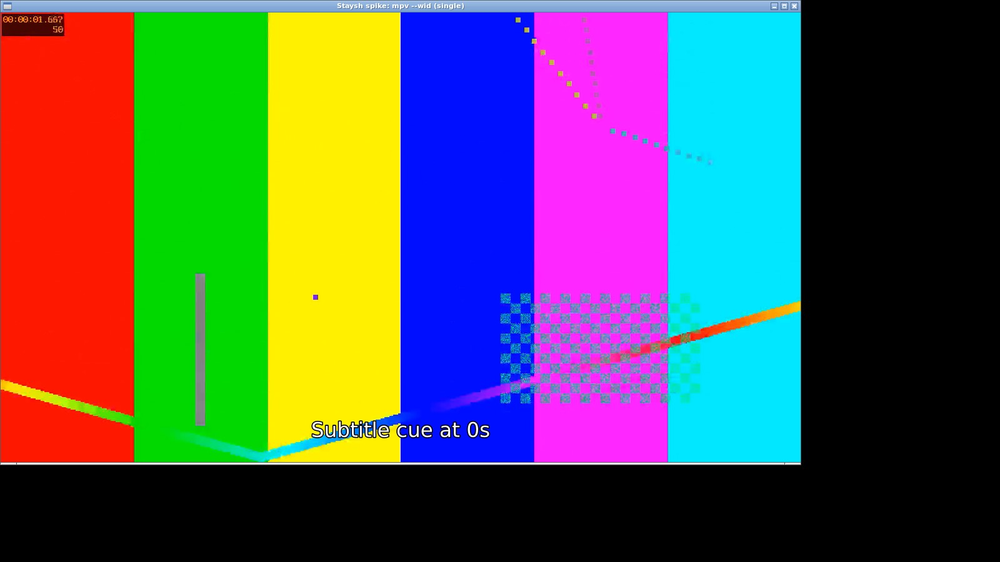
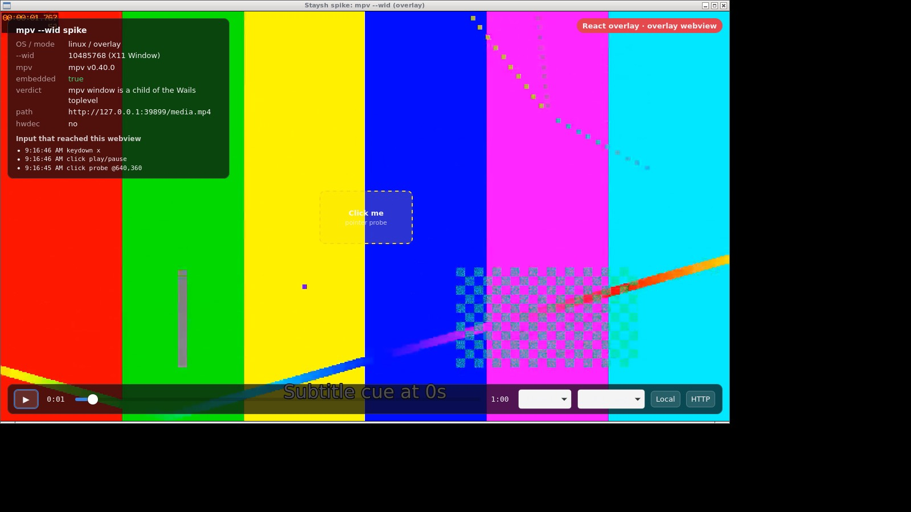
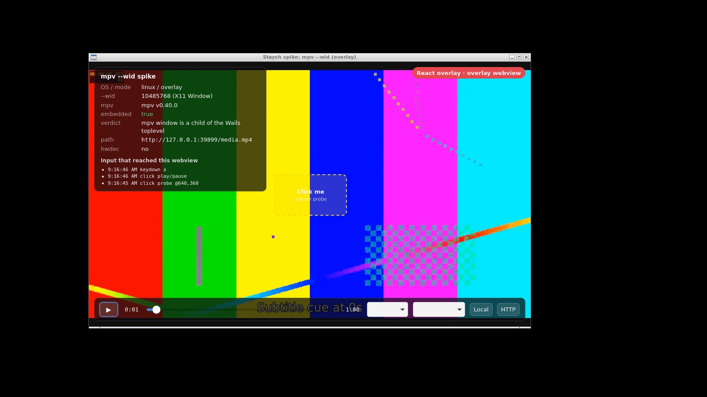
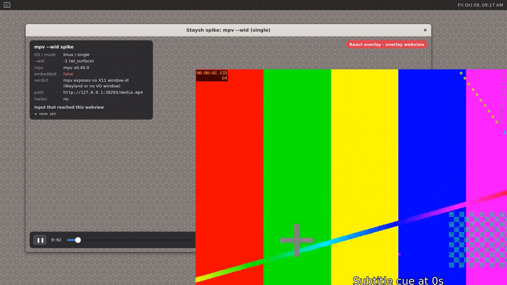
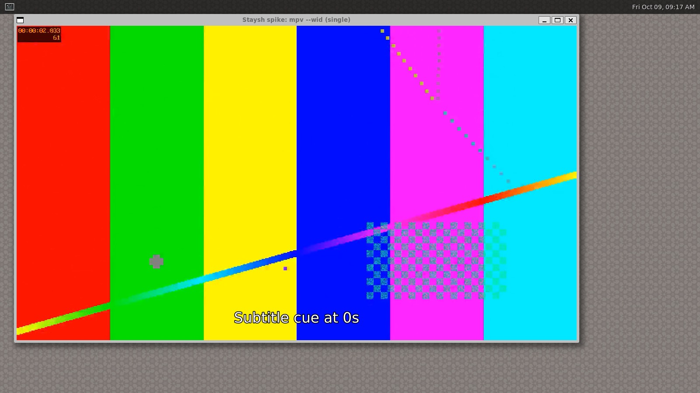

# Spike: mpv child process via `--wid` + JSON IPC in a Wails v3 window

Issue: [#2](https://github.com/k22i/Sinag/issues/2) · Epic: [#1](https://github.com/k22i/Sinag/issues/1) · Date: 2026-10-09
Spike code: [`spikes/mpv-wid-ipc/`](../../spikes/mpv-wid-ipc/) (throwaway). Raw results: [`spikes/mpv-wid-ipc/results/`](../../spikes/mpv-wid-ipc/results/).

## Verdict

**Partially works.** The JSON IPC half works everywhere. The `--wid` embedding half works only where the OS supports cross-process window embedding:

- **Windows: works.** mpv embeds as a child HWND, and a transparent WebView2 draws the React UI over the video in one window. This needs one fix-up: push mpv's HWND to the bottom of the z-order.
- **Linux X11: works.** This one needs a second, transparent overlay window. An X11 child window always paints over the GTK content, so the UI can't share the window with the video.
- **macOS: fails.** mpv 0.41 ignores `--wid` on macOS and opens its own window. An `NSView*` is meaningless in another process anyway.
- **Linux Wayland: fails.** Wayland has no foreign-surface embedding. mpv opens its own window. Running the app *and* mpv under **XWayland** embeds fine.

So the child-process approach can't be the single cross-platform answer. macOS and native Wayland need the in-process render API (#4) whatever happens. Recommendation and trade-offs are [at the end](#recommendation).

## Results matrix

| | Embedded in app window | React overlay visible over video | Input reaches overlay | JSON IPC (play/pause/seek/tracks/observe) | Local file + HTTP URL |
|---|---|---|---|---|---|
| **Windows** (Server 2025, WebView2 153, mpv 0.41.0) | ✅ child HWND | ✅ same window, once mpv's HWND is put at the bottom of the z-order (or with WebView2 composition hosting) | ✅ clicks + keys | ✅ | ✅ |
| **macOS** (27.0.1 arm64, mpv 0.41.0) | ❌ mpv opens its own top-level window | ❌ (separate window) | n/a | ✅ | ✅ |
| **Linux X11** (GTK 4.18 / WebKitGTK 2.54, mpv 0.40.0) | ✅ child X window | ⚠️ only with a 2nd transparent overlay window; in one window the video covers the UI | ✅ clicks + keys (with `--input-cursor-passthrough`) | ✅ | ✅ |
| **Linux Wayland** (Weston 14, native) | ❌ mpv opens its own `xdg_toplevel` | ❌ | n/a | ✅ | ✅ |
| *Linux XWayland* (app + mpv forced to X11 on Wayland) | ✅ child X window | ⚠️ overlay window not stacked/positioned by Weston's XWM; untested on Mutter/KWin | not tested | ✅ | ✅ |

✅ works · ⚠️ partially works / with caveats · ❌ fails

### How this was tested (read before trusting the numbers)

- **macOS:** on a real Mac (Apple silicon), with the official mpv 0.41.0 build. No screenshots: the terminal session didn't have Screen Recording permission. The "own window" result comes from `CGWindowListCopyWindowInfo`: mpv's pid owned one on-screen 1280×720 window at a different position from the Wails window.
- **Windows:** on GitHub-hosted `windows-2025` runners ([workflow](../../.github/workflows/spike-mpv-wid-ipc.yml)), no GPU, so mpv used software decoding. Screenshots come from the runner's desktop session, and the runner's own console window sometimes shows in the background.
- **Linux:** headless in Docker on arm64 (Debian trixie): Xvfb + openbox + picom for X11, headless Weston 14 for Wayland/XWayland, llvmpipe software GL. These aren't real desktops. Results that depend on a WM or compositor (stacking, positioning) should be re-checked on GNOME/KDE before we rely on them.
- Each run is a scripted self-test (`SPIKE_SELFTEST`). It plays a local file, checks `duration`/`track-list`/`vo-configured`, then runs pause, seek to 20 s, resume and `aid` switch. It then plays the same file over loopback HTTP and a public HTTPS URL, and injects a click on a probe box, a click on the play button and a key press (X11 via `xdotool`, Windows via `SendInput`).

## Per OS

### Windows: works, in a single window

`WebviewWindow.NativeWindow()` returns the top-level HWND, which goes to mpv as `--wid=<uint32>`. mpv creates its own child window (class `mpv`) under it, and resizes it with the parent via a WinEvent hook. All IPC steps passed in all four runs.

We ran four variants on each of four CI runs:

| Variant | Result |
|---|---|
| `single-raw`: mpv's HWND left as mpv creates it | **Racy.** What you see depends on which child HWND is created first. Run 1 (WebView2 first): UI visible over the video. Run 4 (mpv first): the video covers the UI. Clicks still reached the webview in both. |
| `single`: after mpv creates its HWND we call `SetWindowPos(mpv, HWND_BOTTOM)` + `EnableWindow(mpv, FALSE)` | ✅ Transparent React UI over the video in runs 1, 3 and 4 (in run 2 a misaimed test click raised the runner console over the window). Probe click and key reached the webview in all four runs; play-button click in runs 3 and 4, the runs where its coordinates were right. |
| `composition`: Wails `WebView2CompositionHosting: true` (DirectComposition target is *topmost* over child HWNDs) | ✅ Same as `single` (UI visible in runs 1, 3 and 4; run 2 obscured the same way). The hit-test lands on the Wails HWND, which forwards input to WebView2. |
| `overlay`: second frameless, transparent, owned window | ❌ / unneeded. Wails' transparent background rendered **opaque white** on a frameless top-level window, so it hid the video. Not pursued, because `single` already works. |

| mpv HWND at bottom (`single`) | Composition hosting |
|---|---|
|  |  |

| Raw, WebView2 created first (run 1) | Raw, mpv created first (run 4) |
|---|---|
|  |  |

Overlay window variant (opaque white overlay window, video hidden underneath):

### macOS: fails

mpv 0.41's `--wid` is only read by its X11, Win32 and Android backends (`video/out/x11_common.c`, `w32_common.c`, `android_common.c`). The Cocoa backend ignores it, and the docs no longer mention macOS. The old Cocoa `--wid` took an `NSView*`, which is only valid inside the process that owns it, so it was libmpv-only even then. We passed the content view's pointer anyway: mpv opened a separate top-level window, and the self-test recorded `mpvOnScreenWindows: 1` at `1280,408 1280x720` while the host was at `100,100`. Everything over IPC worked, with `hwdec=videotoolbox`.

macOS has no API for putting another process's view inside our window. The workaround would be a borderless mpv window glued behind a transparent Wails window. That fights the window server (z-order across two apps, Spaces, Mission Control, a second Dock icon), so we didn't pursue it. **macOS needs the render API (#4).**

### Linux X11: works, but with a second window for the overlay

We get the XID from the GTK4 surface (`gdk_x11_surface_get_xid(gtk_native_get_surface(win))`, on the GTK thread). mpv creates its own window as a **child of the Wails toplevel** and covers it, as confirmed with `XQueryTree`/`xwininfo` (`("gl" "mpv") 1280x720+0+0` under the Wails window).

- **Single window: video covers the UI.** An X11 child window always paints over its parent's content, and GTK4 draws the WebKit view into the toplevel itself. So the React UI is invisible, even though input still reaches it.
- **Overlay window: works.** A second frameless, transparent Wails window, made transient-for the main window and given the main window's bounds, shows the React UI over the video. Clicks and keys go to it. It followed the main window through a move and resize (`WindowDidMove` / `WindowDidResize` → `SetBounds`). Lag during a live drag was not measured. It needs a compositing manager for the transparency (every mainstream X11 desktop has one).

| Single window: UI hidden under the video | Overlay window | Overlay after move + resize |
|---|---|---|
|  |  |  |

### Linux Wayland: fails; XWayland works

Wayland deliberately has no way to embed another client's surface, and mpv 0.41's Wayland backend doesn't read `--wid`. On Weston, mpv opened its own toplevel next to the app (screenshot below). Forcing both onto **XWayland** (`GDK_BACKEND=x11` for the app, `--gpu-context=x11egl` for mpv) embedded correctly, exactly as on X11. The overlay window was neither stacked nor positioned by Weston's minimal X window manager, which centres transients and ignores client positioning. Mutter and KWin behave more like regular X WMs, but **that is untested**.

| Native Wayland: separate mpv window | XWayland: embedded |
|---|---|
|  |  |

## JSON IPC

This works identically on every platform, and it's the part worth keeping regardless of how video gets into the window.

- Transport: Unix socket (macOS/Linux), named pipe `\\.\pipe\…` on Windows. On Windows, use `github.com/Microsoft/go-winio`. A plain `os.OpenFile` handle serialises concurrent reads and writes.
- Protocol: one JSON object per line, `{"command": [...], "request_id": n}`. Replies carry `request_id`. Events carry `event`. For state, we used `observe_property` with ids, so `property-change` events stream `time-pos`, `duration`, `pause`, `track-list`, `vo-configured`, `path`, `hwdec-current`.
- The client is ~150 lines of Go ([`mpvipc.go`](../../spikes/mpv-wid-ipc/mpvipc.go)). The command and property model is the same one libmpv's client API exposes (`mpv_command`, `mpv_observe_property`), so a Go player interface over it would carry over to #3/#4.

Indicative timings from the self-test (hosted/headless machines, software decoding on Windows/Linux, so not baselines; those are #7):

| | mpv launch → IPC connected | `loadfile` → `time-pos ≥ 1.0 s` (local file) | pause / seek reflected in observed props | loopback HTTP | public HTTPS (1 MB MP4) |
|---|---|---|---|---|---|
| macOS (arm64, videotoolbox) | 420–560 ms | 1.6–3.1 s (first, cold run 3.1 s) | < 30 ms | 1.0 s | 1.4–1.5 s |
| Windows (CI, no GPU) | 350–440 ms | 2.2–2.3 s | < 30 ms | 1.8–2.0 s | 1.6–1.9 s |
| Linux X11 (Docker, llvmpipe) | 100–190 ms | 1.1–1.3 s | < 30 ms | 1.1 s | n/a |

The "≥ 1.0 s" figure includes one second of playback, so time to first frame is roughly that minus 1 s. The "< 30 ms" figures are limited by the test's 25 ms polling.

Process memory on macOS while playing 720p: the spike app was ~105 MB RSS and mpv ~280 MB. Official mpv 0.41.0 downloads are 41 MB (macOS arm64 zip, 99 MB unpacked `.app`) and 73 MB (Windows x86_64 MSVC zip).

## Gotchas we hit (each applies to the real app if we keep this approach)

1. **mpv silently falls back to a VO that ignores `--wid`.** In the container, GPU auto-probing rejected llvmpipe and mpv fell back to `vo=sdl`, which opened its own window with no error. We must pin `--vo=gpu-next` (plus `--gpu-context` where needed) and verify after start: `vo-configured == true` and `window-id` present.
2. **`--wid=0` means "draw on the desktop / root window".** Our first Windows overlay run launched mpv before Wails had created the HWND and painted video onto the desktop. Wait for a real native handle (window shown) before spawning, and never pass 0.
3. **Windows z-order between mpv's HWND and WebView2 is a race.** Always `SetWindowPos(mpvHwnd, HWND_BOTTOM)` once mpv's window exists (find it with `FindWindowEx(host, "mpv")`), and re-assert it if mpv recreates its window (VO reinit). Alternatively, use composition hosting.
4. **X11 clicks need `--input-cursor-passthrough=yes`.** With `--input-cursor=no` alone, clicks over mpv's child window reached the webview with no WM, but were lost under openbox (passive button grab replay). Passthrough gives mpv's window an empty input shape and fixed it.
5. **Wails v3 beta.28, GTK4: `BackgroundTypeTransparent` is a no-op.** `setTransparent()` is an empty stub, so windows keep the Adwaita background. We had to add CSS (`window { background: transparent }`) ourselves. Worth a Wails issue/PR.
6. **Wails v3 beta.28, Windows: `Focus()` on a window whose WebView2 isn't ready panics** (nil controller in `Chromium.GetController`).
7. **Orphaned mpv.** `app.Run()` doesn't return on macOS (the process exits from inside the Cocoa run loop), so cleanup placed after it never ran and mpv kept playing. Use `Options.OnShutdown`. Even then, if the host crashes or is `SIGKILL`ed, mpv survives (verified). The real app needs a parent-death guard: a Job Object with `KILL_ON_JOB_CLOSE` on Windows, `PR_SET_PDEATHSIG` on Linux, and on macOS a watchdog (e.g. an mpv Lua script polling the parent pid, or quitting when the IPC socket closes).
8. No sound device on CI/containers: mpv deselects audio unless `--ao=null`. That only matters for test rigs.

## Recommendation

1. **Don't ship the child-process `--wid` approach as the only playback path.** It can't work on macOS or native Wayland, and #4 (render API) is required for those whatever we decide.
2. **Keep the JSON-IPC-shaped player interface in Go.** Commands plus observed properties are the same model as libmpv's client API, so the React controls and Go service written against it carry over to #3/#4 unchanged.
3. For **Windows and X11**, `--wid` embedding is a proven fallback. The Windows single-window result is clean. X11 needs the two-window overlay, which is more moving parts (WM stacking, move/resize sync, needs a compositor). If #4's render API works well on macOS and Wayland, using it **everywhere** gives one code path and no window juggling, and is probably simpler overall than a per-OS hybrid. That's the call for the M0 gate (#8) once #3 and #4 report.
4. If we do end up shipping a child process anywhere, budget for gotchas 1–4 and 7 above. Bundle mpv per platform (#77–#79) rather than relying on the user's.

## Open risks / not covered

- No real GPU on Windows/Linux runs. Hardware decoding, HDR, and tearing or flicker of the overlay during playback weren't exercised.
- Live window drag / resize smoothness of the X11 overlay window, and DPI scaling (Windows non-100 %, X11 HiDPI), weren't measured.
- XWayland overlay behaviour on Mutter/KWin was not tested (only Weston's XWM).
- Fullscreen (both the mpv child and the overlay window) was not tested.
- Real GNOME/KDE desktops and real Windows 10/11 desktops (vs Server 2025 runner) were not tested.

## Reproduce

See [`spikes/mpv-wid-ipc/README.md`](../../spikes/mpv-wid-ipc/README.md). In short: `scripts/make-media.sh`, build the frontend, then:

- Linux: `docker build -t sinag-spike-linux scripts/linux && docker run --rm -v "$PWD":/spike sinag-spike-linux scripts/linux/run.sh x11 overlay`
- Windows: run the `spike-mpv-wid-ipc` workflow
- macOS: `SPIKE_SELFTEST=$PWD/results/macos-single.json ./bin/spike`
